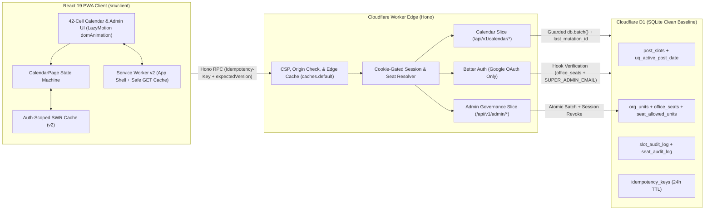
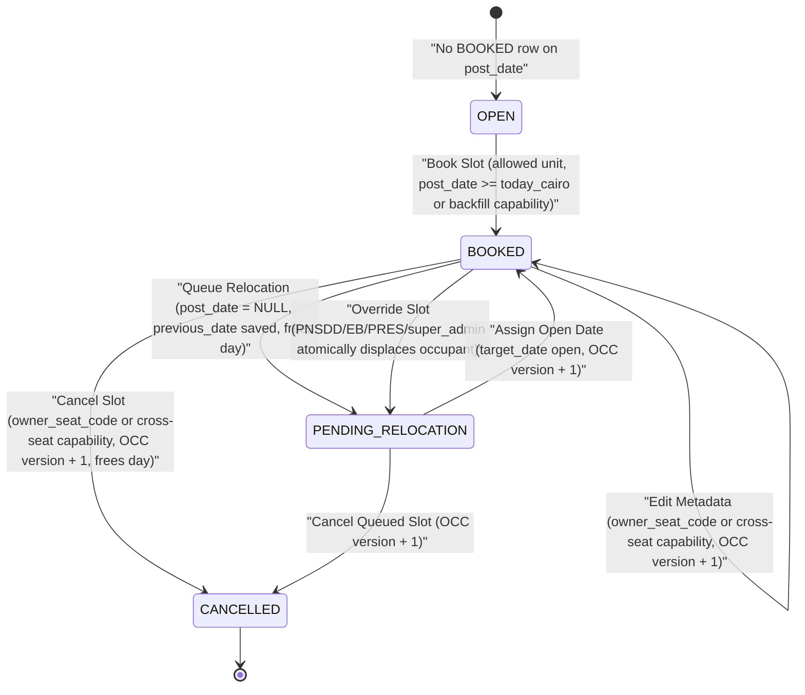

# NVMSA OS v1.0 — Platform Core & Content Calendar

* **Author:** Mostafa Yaser
* **Status:** Proposed
* **Date:** 2026-11-26

---

## Overview

NVMSA OS v1.0 is the mobile-first web Progressive Web App (PWA) for **New Valley Medical Students' Association (NVMSA)** hosted on Cloudflare Workers and Cloudflare D1. It establishes two scoped foundations in one release:

1. **Platform Core**: Google OAuth-only authentication, D1-backed official leadership seats (`office_seats`) and organizational units (`org_units`) seeded from `docs/ROLE_HIERARCHY.md`, capability-based authorization, and browser cache isolation.
2. **Module 1 (Content Calendar)**: A shared 1-post-per-Cairo-day scheduling ledger (`Africa/Cairo`) where unauthenticated members and officers inspect monthly availability without logging in, official seat holders book slots scoped to their organizational unit, and Executive Board / publishing leads coordinate relocations without double-booking or lost edits.

## The Problem

NVMSA's current scheduling workflow and v1.0 prototype break down across four operational areas:

1. **Officers and members cannot distinguish open days from reserved days at a glance**: In the current UI (`src/client/modules/calendar/components/DayCell.tsx`), both open and booked cells sit on white surfaces, open-day labels render in low-contrast `text-slate-300`, and applying a unit filter (`CalendarPage.tsx`) removes other units' slots from the map so occupied days look open. Fixed 42-cell month grids also render adjacent-month overflow days whose occupancy is not fetched by the current single-month query.
2. **Concurrent bookings and edits lack atomic guarantees**: Slot writes and audit log inserts currently run as separate queries rather than one atomic D1 batch, slot cancellations omit optimistic concurrency checks (`expectedVersion`), network retries on mobile cellular connections can trigger duplicate-write conflicts without idempotency keys, and `todayCairo` freezes on initial mount if a PWA stays open across Cairo midnight.
3. **Seat governance is coupled to static lists and fragile accounts**: Hardcoded entity arrays (`src/shared/constants/`) and a 3-tier role enum (`officer`, `eb`, `admin`) cannot model NVMSA's 13 leadership seats (including dual-unit `LEO & LORE` covering `SCOPE` and `SCORE`) or support clean annual handovers in D1 without code deploys.
4. **Open password sign-up and unpurged browser caches leak data**: Enabling email/password sign-up without locking custom role fields leaves privilege-escalation surface open, and signing out leaves privileged Executive Board notes and relocation queues cached in `localStorage` for subsequent users on shared phones.

## Goals

* **Unmistakable Mobile Availability**: Unauthenticated visitors and officers see live monthly schedules on a fixed 42-cell grid (`0.00` layout shift) where Open, Booked, Past, and Today states use distinct surfaces, WCAG AA contrast (`≥ 4.5:1`), and non-color-only icons, with non-matching filtered units dimmed rather than hidden.
* **Strict 1-Post-Per-Cairo-Day Enforcement**: Enforce at most one active booked post per `Africa/Cairo` calendar date (`YYYY-MM-DD`) at the D1 database level, blocking non-privileged backdating and synchronizing client clocks across Cairo midnight and foreground resume.
* **Atomic Concurrency and Accountability**: Guarantee slot state mutations, append-only audit logs, and retry safety inside atomic D1 batch operations, returning clear conflict states (`409` date collision with winner summary; `412` stale version) rather than silent overwrites.
* **Seat-Based Google OAuth Governance**: Authenticate exclusively via Google OAuth (`emailAndPassword` disabled) against D1-backed `office_seats` (13 official Gmail addresses including `lpoo.nvmsa@gmail.com`) and `org_units`, editable by `super_admin` and `PRES` with immediate session revocation when a seat email changes.
* **Unit-Scoped Booking**: Restrict Standing Committee Officers and Support Division Directors to booking slots only for their assigned `org_unit`(s), while allowing `LEO & LORE` to choose between `SCOPE` and `SCORE`.
* **Hidden `super_admin` Isolation**: Keep `mostafa.yaser.developer@gmail.com` (`super_admin`) excluded from user-facing directories and role pickers and masked in officer-visible audit logs and slot summaries while preserving true actor attribution in D1.
* **Fast Two-Step Relocation Flow**: Let seat owners and authorized leads release a booked day immediately to the Relocation Queue and assign it onto any open day across months through Two-Step Relocation Placement Mode.

## Non-Goals

* **Module 2 (`Activities & Events`) and Module 3 (`Recruitment & Member Hub`)**: Deferred out of this build; placeholder module tabs will not appear in v1.0 mobile navigation.
* **Email OTP and Custom-Domain Email Delivery**: Deferred to a follow-up milestone once custom domain DNS and transactional email sending are configured.
* **Legacy v1.0 `calendar_slots` Data Backfill**: Pre-launch `nvmsa-os-db` will be reset cleanly to the new schema before release rather than carrying Expand-and-Contract backfill migrations from prototype data.
* **Multi-University Tenancy or Native App Store Binaries**: NVMSA OS v1.0 targets NVMSA's single association instance as an installable web PWA.

## Open Questions

None (all three architectural questions from brainstorming were resolved by the author and incorporated into the Technical Plan below).

## Critical User Journeys (CUJs)

### CUJ 1: Officer or Member Checks Monthly Availability Without Signing In

* **Given**: An unauthenticated NVMSA officer or member opens the pinned PWA link on mobile (or reloads offline with a cached snapshot).
* **When**: They view the current month's 42-cell grid, filter by a committee such as `SCOPH`, or swipe to the next month.
* **Then**: Booked days remain visibly distinct from open days even when filtered (non-matching booked days dim rather than disappearing), adjacent-month overflow cells reflect true occupancy, and privileged internal notes, relocation queues, and `super_admin` identities are absent from the payload.

### CUJ 2: Standing Committee Officer Books a Unit-Scoped Open Day

* **Given**: An officer holding an allowlisted official seat (such as `LPO` for `SCOPH` or `LEO & LORE` for `SCOPE` / `SCORE`) taps Sign In via Google OAuth (outside restricted in-app WebViews, choosing their seat account).
* **When**: They tap an open current or future `Africa/Cairo` date, enter post title and format, select from their permitted unit(s), and submit.
* **Then**: The server verifies seat authorization and Cairo date rules, commits the slot and audit entry atomically in D1, updates affected month caches, and marks the day booked on the calendar.

### CUJ 3: Concurrent Booking Collision (`409`) or Stale Edit (`412`)

* **Given**: Two authorized seat holders open the same open Cairo date (or edit the same booked slot) concurrently.
* **When**: Both submit within milliseconds of each other.
* **Then**: D1 commits the first write atomically and rejects the second with a structured `409` conflict (including the winning slot's summary) or `412` stale-version notice, updating the losing client's calendar immediately without leaving partial audit rows.

### CUJ 4: Two-Step Relocation Placement Across Months

* **Given**: A seat owner (or authorized override seat such as `PNSDD` or `EB`) opens a booked slot that needs to be rescheduled.
* **When**: They move the slot to the Relocation Queue (clearing its booked date atomically) and later choose `"Assign New Day"` to enter Placement Mode and tap an open future Cairo date in the current or next month.
* **Then**: Booked days stay visibly locked during Placement Mode, tapping an open date commits the relocation atomically, and both the old and new month caches plus the Relocation Queue refresh together.

### CUJ 5: `PRES` or `super_admin` Updates Official Seats or Org Units

* **Given**: `PRES` or `super_admin` opens the lazy-loaded admin governance view.
* **When**: They update an official seat's bound Gmail address (or add/deactivate an organizational unit using pre-compiled palette tokens).
* **Then**: D1 updates the governance record inside an atomic batch, revokes any active sessions held by the displaced email so permissions drop immediately, hides `super_admin` from `PRES`'s directory view, and prevents `PRES` from removing their own `PRES` seat without safeguard checks.


---

## Technical Plan (Architecture)

### 1. System Topology and Boundary Rules

NVMSA OS v1.0 runs as a single-repo modular monolith deployed on Cloudflare Workers with Cloudflare D1. Compile-time and ESLint rules keep `src/shared/` free of React, Hono, or Drizzle dependencies, and restrict `src/client/` to `import type { AppType }` from `src/server/`.



### 2. Clean D1 Reset Strategy and Canonical Schema

Because `wrangler.jsonc` currently binds a pre-launch D1 instance (`nvmsa-os-db`, `database_id: 1271c546-fe90-410c-b716-070882d6b3f6`) with legacy `0000` and `0001` migration entries, the pre-launch cutover provisions a clean D1 database ID (or wipes remote/local tables and `d1_migrations` cleanly) before applying the unified `0000_baseline.sql` and `0001_seed_nvmsa.sql` migrations. Simultaneously, `wrangler.jsonc` adds a separate `env.preview` D1 binding so non-production checks never touch production data, Service Worker cache bumps to `nvmsa-os-v2`, and client SWR keys move to `nvmsa_os_swr:v2:<scope>:`.

#### Canonical D1 Tables (`drizzle/0000_baseline.sql`)

```sql
-- Better Auth identity & session tables (emailAndPassword disabled)
CREATE TABLE user (
  id             TEXT PRIMARY KEY NOT NULL,
  name           TEXT NOT NULL,
  email          TEXT NOT NULL UNIQUE,
  email_verified INTEGER NOT NULL DEFAULT 0,
  image          TEXT,
  created_at     INTEGER NOT NULL,
  updated_at     INTEGER NOT NULL
);

CREATE TABLE session (
  id         TEXT PRIMARY KEY NOT NULL,
  expires_at INTEGER NOT NULL,
  token      TEXT NOT NULL UNIQUE,
  created_at INTEGER NOT NULL,
  updated_at INTEGER NOT NULL,
  ip_address TEXT,
  user_agent TEXT,
  user_id    TEXT NOT NULL REFERENCES user(id) ON DELETE CASCADE
);

CREATE TABLE account (
  id                       TEXT PRIMARY KEY NOT NULL,
  account_id               TEXT NOT NULL,
  provider_id              TEXT NOT NULL,
  user_id                  TEXT NOT NULL REFERENCES user(id) ON DELETE CASCADE,
  access_token             TEXT,
  refresh_token            TEXT,
  id_token                 TEXT,
  access_token_expires_at  INTEGER,
  refresh_token_expires_at INTEGER,
  scope                    TEXT,
  created_at               INTEGER NOT NULL,
  updated_at               INTEGER NOT NULL
);

CREATE TABLE verification (
  id         TEXT PRIMARY KEY NOT NULL,
  identifier TEXT NOT NULL,
  value      TEXT NOT NULL,
  expires_at INTEGER NOT NULL,
  created_at INTEGER,
  updated_at INTEGER
);

-- 11 Canonical Organizational Units (seeded in 0001_seed_nvmsa.sql)
CREATE TABLE org_units (
  id           TEXT PRIMARY KEY NOT NULL, -- 'SCOPH','SCORP','SCOME','SCORA','SCOPE','SCORE','CBSDD','PSDD','PNSDD','RSDD','EB'
  code         TEXT NOT NULL UNIQUE,
  name         TEXT NOT NULL,
  kind         TEXT NOT NULL CHECK (kind IN ('COMMITTEE', 'DIVISION', 'BOARD')),
  accent_token TEXT NOT NULL CHECK (accent_token IN (
    'orange','red','green','slate','blue','sky','amber','violet','teal','emerald','indigo','rose'
  )),
  is_active    INTEGER NOT NULL DEFAULT 1,
  created_at   TEXT NOT NULL,
  updated_at   TEXT NOT NULL
);

-- 13 Visible Official Seats (super_admin lives strictly in SUPER_ADMIN_EMAIL secret)
CREATE TABLE office_seats (
  seat_code      TEXT PRIMARY KEY NOT NULL, -- 'PRES','VP','SecGen','TREAS','LPO','LORP','LOME','LORA','LEO & LORE','CBSDD','PSDD','PNSDD','RSDD'
  branch         TEXT NOT NULL CHECK (branch IN ('EXECUTIVE_BOARD', 'STANDING_COMMITTEE', 'SUPPORT_DIVISION')),
  title          TEXT NOT NULL,
  tier           TEXT NOT NULL CHECK (tier IN ('eb_president', 'eb', 'officer_sd_ops', 'officer_sc', 'officer_sd')),
  assigned_email TEXT NOT NULL UNIQUE,      -- stored trimmed lowercase; seeded with lpoo.nvmsa@gmail.com etc.
  is_active      INTEGER NOT NULL DEFAULT 1,
  updated_at     TEXT NOT NULL
);

-- 1:N Seat-to-Org-Unit scope (LEO & LORE -> SCOPE + SCORE; '*' wildcard handled via NULL/flag or explicit capabilities)
CREATE TABLE seat_allowed_units (
  seat_code   TEXT NOT NULL REFERENCES office_seats(seat_code) ON DELETE CASCADE,
  org_unit_id TEXT NOT NULL REFERENCES org_units(id) ON DELETE RESTRICT,
  PRIMARY KEY (seat_code, org_unit_id)
);

-- Seat Governance Audit Trail
CREATE TABLE seat_audit_log (
  id          TEXT PRIMARY KEY NOT NULL,
  target_type TEXT NOT NULL CHECK (target_type IN ('SEAT', 'ORG_UNIT')),
  target_id   TEXT NOT NULL,
  actor_id    TEXT NOT NULL,
  actor_role  TEXT NOT NULL,
  action      TEXT NOT NULL,
  diff_json   TEXT NOT NULL,
  request_id  TEXT NOT NULL,
  created_at  TEXT NOT NULL
);

-- Content Calendar Slots (3-state lifecycle; seat-scoped edit ownership via owner_seat_code)
CREATE TABLE post_slots (
  id                TEXT PRIMARY KEY NOT NULL,
  post_date         TEXT, -- 'YYYY-MM-DD' when BOOKED; NULL when PENDING_RELOCATION
  status            TEXT NOT NULL CHECK (status IN ('BOOKED', 'PENDING_RELOCATION', 'CANCELLED')),
  org_unit_id       TEXT NOT NULL REFERENCES org_units(id) ON DELETE RESTRICT,
  content_type      TEXT NOT NULL CHECK (content_type IN ('POST', 'PHOTO', 'REEL', 'COLLAB', 'STORY_CAMPAIGN')),
  title             TEXT NOT NULL,
  notes             TEXT,
  asset_url         TEXT,
  relocation_reason TEXT,
  previous_date     TEXT,
  owner_seat_code   TEXT NOT NULL, -- Authorizes future edits/relocations across seat handovers ('SUPER_ADMIN' for super_admin)
  created_by_id     TEXT NOT NULL,
  created_by_name   TEXT NOT NULL,
  version           INTEGER NOT NULL DEFAULT 1,
  last_mutation_id  TEXT NOT NULL, -- Per-write nonce guarding batched audit/idempotency inserts on 0-row OCC
  created_at        TEXT NOT NULL,
  updated_at        TEXT NOT NULL,
  CHECK (
    (status = 'BOOKED' AND post_date IS NOT NULL) OR
    (status = 'PENDING_RELOCATION' AND post_date IS NULL) OR
    (status = 'CANCELLED')
  )
);

-- Hard 1-post-per-Cairo-day invariant
CREATE UNIQUE INDEX uq_active_post_date
  ON post_slots(post_date)
  WHERE status = 'BOOKED';

CREATE INDEX idx_post_slots_status_date ON post_slots(status, post_date);
CREATE INDEX idx_post_slots_owner_seat ON post_slots(owner_seat_code, status);

-- Idempotency store (24h TTL)
CREATE TABLE idempotency_keys (
  key           TEXT NOT NULL,
  user_id       TEXT NOT NULL,
  route         TEXT NOT NULL,
  request_hash  TEXT NOT NULL,
  response_code INTEGER NOT NULL,
  response_body TEXT NOT NULL,
  created_at    TEXT NOT NULL,
  expires_at    TEXT NOT NULL,
  PRIMARY KEY (key, user_id, route)
);

CREATE INDEX idx_idempotency_expires ON idempotency_keys(expires_at);

-- Slot Audit Log (raw actor_id & actor_role saved in D1; masked in DTO projection for non-super_admin)
CREATE TABLE slot_audit_log (
  id         TEXT PRIMARY KEY NOT NULL,
  slot_id    TEXT NOT NULL REFERENCES post_slots(id) ON DELETE CASCADE,
  actor_id   TEXT NOT NULL,
  actor_name TEXT NOT NULL,
  actor_role TEXT NOT NULL,
  action     TEXT NOT NULL CHECK (action IN ('BOOKED', 'UPDATED', 'QUEUED_RELOCATION', 'RELOCATED', 'CANCELLED', 'ADMIN_OVERRIDE')),
  diff_json  TEXT NOT NULL,
  request_id TEXT NOT NULL,
  created_at TEXT NOT NULL
);

CREATE INDEX idx_slot_audit_slot_time ON slot_audit_log(slot_id, created_at DESC);
```

### 3. Formal 3-State Slot Machine and Guard Invariants



* **Cairo Date Authority**: Server evaluates `"today"` exclusively via `Intl.DateTimeFormat('en-CA', { timeZone: 'Africa/Cairo' })`. Non-privileged seats (`officer_sc`, `officer_sd`) cannot book or relocate onto `post_date < today_cairo`.
* **Unit-Scoped Booking**: `officer_sc` and `officer_sd` seats may book or update `org_unit_id` only within their `seat_allowed_units` entries (`LEO & LORE` selects `SCOPE` or `SCORE`). `eb_president`, `eb`, `officer_sd_ops` (`PNSDD`), and `super_admin` default to `EB` or `PNSDD` and may book any active `org_unit_id`.
* **Seat-Scoped Ownership**: Mutations by `officer_sc` / `officer_sd` require `slot.owner_seat_code === actor.seatCode`. `PNSDD`, `VP`, `SecGen`, `TREAS`, `PRES`, and `super_admin` hold cross-seat edit, relocate, cancel, override, and backfill capabilities (`super_admin` mutations also require a non-empty `reason`).

### 4. Guarded Atomic `db.batch()` and 3-Layer Concurrency

Because D1 `db.batch()` does not abort when an `UPDATE ... WHERE id = ? AND version = ?` matches `0` rows, `D1SlotRepository` uses command-scoped atomic methods (`bookSlotAtomic`, `updateSlotAtomic`, `queueRelocationAtomic`, `relocateSlotAtomic`, `overrideSlotAtomic`, `cancelSlotAtomic`) behind `ISlotRepository`:

1. **Layer 1 (`Idempotency-Key`)**: Every `POST`, `PATCH`, and `DELETE` checks `idempotency_keys` (`WHERE key = ? AND user_id = ? AND route = ? AND expires_at > ?`). Matching `request_hash` replays the stored response; differing `request_hash` returns `422 IDEMPOTENCY_CONFLICT` (`UnprocessableEntityError`). Expired rows are pruned asynchronously via `ctx.waitUntil()` (`DELETE ... LIMIT 20`).
2. **Layer 2 (OCC `version` + Nonce Gate)**: Every mutation generates a fresh `last_mutation_id` UUID before executing `db.batch()`:
   * Statement 1 updates `post_slots` with `SET ..., version = version + 1, last_mutation_id = ?nextMutationId WHERE id = ?id AND version = ?expectedVersion AND status != 'CANCELLED'`.
   * Statement 2 runs `INSERT INTO slot_audit_log (...) SELECT ... FROM post_slots WHERE id = ?id AND last_mutation_id = ?nextMutationId`.
   * Statement 3 runs `INSERT INTO idempotency_keys (...) SELECT ... FROM post_slots WHERE id = ?id AND last_mutation_id = ?nextMutationId`.
   * If Statement 1 affects `0` rows (`meta.changes === 0`), Statements 2 and 3 insert `0` rows automatically; the repository reads current state and throws `404 NotFoundError` or `412 PreconditionFailedError` with the latest slot snapshot.
3. **Layer 3 (Hard Uniqueness `uq_active_post_date`)**: Unique-constraint matching inspects the exact `uq_active_post_date` constraint name (never catching unrelated PK/email unique errors as date collisions) and returns `409 ConflictError` populated with the occupying slot's masked `PublicSlotView` and next open Cairo date.
4. **Repository Parity**: `InMemorySlotRepository` mirrors the exact nonce-guarded atomic update, `412` OCC, `409` unique index, and `idempotency_keys` contract under a Shared Repository Contract Test Suite executed against both Miniflare D1 and in-memory implementations.

### 5. Google OAuth-Only Governance and `super_admin` Masking

* **Google OAuth Configuration**: `emailAndPassword` is disabled (`auth.ts`), and Better Auth `socialProviders.google` is configured with `prompt: 'select_account'`, full-page redirect, and non-sensitive scopes (`openid email profile`). Startup validation fails fast if `BETTER_AUTH_URL` (HTTPS outside `development`), `BETTER_AUTH_SECRET` (`>= 32` chars), `GOOGLE_CLIENT_ID`, `GOOGLE_CLIENT_SECRET`, or `SUPER_ADMIN_EMAIL` is missing.
* **Three-Point Allowlist & Live Seat Resolution**:
  1. `user.create.before` and `session.create.before` hooks normalize `email.trim().toLowerCase()`, require `emailVerified === true`, and reject any address not matching an active `office_seats.assigned_email` row or `SUPER_ADMIN_EMAIL`.
  2. `sessionMiddleware` skips D1 session lookups completely when no Better Auth session cookie is present (protecting public reads), logs exceptions via `auth_session_error` rather than swallowing them silently, and resolves current `seatCode`, `tier`, `allowedOrgUnits`, and capability flags live from `office_seats` + `SUPER_ADMIN_EMAIL` (failing closed with `403` on invalid or deactivated seats).
  3. Reassigning `office_seats.assigned_email` in `/api/v1/admin/seats/:seatCode` runs inside `db.batch()` to update `office_seats`, record `seat_audit_log`, and **delete all active `session` rows** belonging to the displaced email (`WHERE user_id IN (SELECT id FROM user WHERE lower(email) = ?oldEmail)`). `PRES` queries exclude `super_admin` entirely and block disabling the sole active `PRES` seat.
* **Mobile PWA & CI Testing Resilience**: Client auth detects embedded WebViews (`WhatsApp`, `Instagram`, `FBAN`/`FBAV`) and instructs users to open in Safari or Chrome; unsaved booking form drafts persist to `sessionStorage` prior to OAuth redirect; local dev and Playwright CI use D1-backed seeded test sessions (creating real `user` + `session` rows linked to `office_seats`) against a fixed staging/local callback URL rather than bypassing D1 via `x-dev-role`.
* **Unified `super_admin` Masking Projector**: D1 stores true `actor_id`, `actor_name`, and `actor_role = 'super_admin'`. One server DTO mapper projects `creatorName` / `actorName` to `"Platform Maintenance"`, `actorRole` to `"system"`, and `actorId` / `creatorId` to `null` across `PublicSlotView`, `ManagedSlotView`, `409` winner summaries, and `GET /slots/:id/history` whenever the caller is not `super_admin`.

### 6. API Contracts (`/api/v1/*`) and Edge Observability

| Method & Path | Access | Key Headers / Query | Response & Error Semantics |
| :--- | :--- | :--- | :--- |
| `GET /api/v1/health` | Public | — | `200` D1 readiness (`SELECT 1` + `org_units`/`office_seats` count > 0) |
| `GET /api/v1/calendar/month` | Public (`Officer+`) | `?ym=YYYY-MM`, `ETag` | `200` `{ month, gridStart, gridEnd, orgUnits, slots, serverTodayCairo }` (edge-cached for public callers via `caches.default`, invalidated on writes) |
| `GET /api/v1/calendar/relocations` | `Seat Holder+` | — | `200` `{ items }` (decoupled from month cache; `LIMIT 100`) |
| `GET /api/v1/calendar/slots/:id/history` | `Seat Holder+` | — | `200` `{ history }` (masked for non-`super_admin`) |
| `POST /api/v1/calendar/slots` | `Seat Holder+` | `Idempotency-Key` | `201` `{ slot, affectedMonths }` or `403` / `409` (with winner) / `422` |
| `PATCH /api/v1/calendar/slots/:id` | Owner Seat / Privileged | `Idempotency-Key` | `200` `{ slot, affectedMonths }` (`expectedVersion` required; `412` on drift) |
| `POST /api/v1/calendar/slots/:id/queue-relocation` | Owner Seat / Privileged | `Idempotency-Key` | `200` `{ slot, affectedMonths }` (`expectedVersion` required; frees `post_date`) |
| `POST /api/v1/calendar/slots/:id/relocate` | Owner Seat / Privileged | `Idempotency-Key` | `200` `{ slot, affectedMonths }` (`expectedVersion` required; `409` / `412`) |
| `POST /api/v1/calendar/slots/override` | `PNSDD`, `EB`, `PRES`, `super_admin` | `Idempotency-Key` | `200`/`201` `{ slot, displacedSlot, affectedMonths }` (`reason` required) |
| `DELETE /api/v1/calendar/slots/:id` | Owner Seat / Privileged | `Idempotency-Key`, `expectedVersion` | `200` `{ slot, affectedMonths }` (`412` on stale version) |
| `GET / PATCH /api/v1/admin/seats` | `PRES`, `super_admin` | `Idempotency-Key` | Lists 13 visible seats; updates `assigned_email`/`is_active` + revokes old sessions |
| `GET / POST / PATCH /api/v1/admin/org-units` | `PRES`, `super_admin` | `Idempotency-Key` | Manages `org_units` (`code`, `name`, `kind`, closed `accent_token`, `is_active`) |

Every `/api/v1/*` response includes a full UUID `X-Request-Id` header (correlated with `cf-ray`) and emits structured JSON logs containing `outcome` (`committed`, `idempotency_replay`, `idempotency_conflict_422`, `occ_stale_412`, `date_race_409`), `seatCode`, `orgUnitId`, `d1RowsRead`, and `d1DurationMs`.

### 7. Client PWA, Visual Contrast, and Lean Motion Architecture

* **Fixed 42-Cell Grid & Full-Range Occupancy**: `buildMonthGrid` (`src/shared/utils/date.ts`) always returns 42 cells (`6 × 7`). `GET /month` queries `[gridCells[0].isoDate .. gridCells[41].isoDate]` so overflow leading/trailing days display accurate occupancy (with non-current-month overflow taps either routed cleanly to `postDate.slice(0, 7)` or jumping smoothly to `M±1`). `YearMonthSchema` validates strict `01`–`12` months (`2020`–`2100`), and `useCairoClock()` updates `"today"` across Cairo midnight and `visibilitychange` events.
* **Unmistakable Open-vs-Booked Clarity & BiDi**: Open days render neutral surfaces with `>= 4.5:1` `text-slate-600` (`Open` / `+` indicator in bookable mode); past unbooked dates render muted non-bookable styling; booked days render tinted committee fills mapped from closed pre-compiled `accent_token` classes, crisp borders, org-unit pill, and lock vs. owner-edit glyph. User text applies `dir="auto"`, `min-w-0`, `line-clamp-2`, and a 120-grapheme cap.
* **CalendarPage Discriminated-Union State Machine**: Replaces independent booleans with `idle | inspectingOrBooking(date) | relocationQueueOpen | placingRelocation(slotSnapshot)`. Filtered views always pass the complete occupancy map into `CalendarGrid` and dim non-matching booked slots (`opacity-30`), preventing booked days from masquerading as Open. In `placingRelocation`, grid mode is forced, past dates lock for non-privileged users, a sticky banner shows `"Tap any open day for [Title]"` + `Cancel`/`Escape`, swiping `M±1` preserves placement state, and `412`/`404` exits Placement Mode cleanly.
* **Lean Motion, Lazy Admin Route, & PWA Hygiene**: Uses `<LazyMotion features={domAnimation} strict>` paired with native Pointer Events and CSS transitions for `BottomSheet` drag-to-dismiss, `visualViewport` keyboard offset, focus trap, scroll lock, horizontal month swipes with `M±1` idle prefetch, and `150ms` `prefers-reduced-motion` crossfades (omitting `domMax`, SVG particles, and `navigator.vibrate()`). Planned Module 2/3 bottom-nav tabs are hidden; `/admin` is route-split behind `PRES`/`super_admin` visibility; `public/sw.js` caches only `res.ok && res.type === 'basic'`, handles offline `/calendar` navigation fallback, and prompts before reloading; SWR cache keys include auth scope (`nvmsa_os_swr:v2:<scope>:`), trigger `BroadcastChannel('nvmsa-calendar')` and `affectedMonths` invalidation, and clear synchronously on `signOut()`.

---

## Alternatives Considered

### Alternative A: Building Modules 2 and 3 (`Activities` and `Member Hub`) in the Same Release

* **Pros**: Ships all three planned roadmap modules in one pass without hiding bottom navigation tabs.
* **Cons**: Neither module has defined workflows, schemas, permission boundaries, or edge cases yet, stalling Content Calendar delivery behind un-specced design work.
* **Reason for Rejection**: Rejected by author: workflows, schemas, and permissions for Modules 2 and 3 are undefined and would delay Module 1 delivery.

### Alternative B: Backward-Compatible `0002` Expand-and-Contract Backfill from Legacy `calendar_slots`

* **Pros**: Preserves pre-launch prototype rows in `calendar_slots` and `calendar_slot_audit_logs` during rollout.
* **Cons**: Carries legacy lowercase enum strings, dead columns, and single-unit assumptions forward into the fresh `office_seats` + `org_units` schema.
* **Reason for Rejection**: Rejected by author: the pre-launch D1 database contains no live production data that must be preserved and can be reset cleanly before launch.

### Alternative C: Email/Password Sign-Up and Launch-Day Email OTP

* **Pros**: Works inside embedded WhatsApp/Instagram WebViews and dynamic wildcard preview URLs without Google Cloud consent setup, and avoids shared-Gmail 2FA prompts across phones.
* **Cons**: Enabling email/password leaves credential management overhead, while launch-day Email OTP requires domain DNS (`SPF`/`DKIM`/`DMARC`), an external transactional email provider, and bounce/deliverability handling before Module 1 can go live.
* **Reason for Rejection**: Rejected by author: Google OAuth verifies the 13 official Gmail seats plus `super_admin` immediately without email infrastructure; Email OTP is deferred to a follow-up milestone once custom-domain email sending is ready.

### Alternative D: Static Hardcoded 13-Email Allowlist Without an Admin Editor

* **Pros**: Eliminates the `/admin` UI, `office_seats` mutation endpoints, session revocation logic, and `seat_audit_log` in v1.0.
* **Cons**: Any mid-term officer handover or new committee addition requires a developer code edit and Worker redeploy.
* **Reason for Rejection**: Rejected by author: `office_seats` and `org_units` must live in D1 and be editable in an admin view by `super_admin` and `PRES`.

### Alternative E: Strict Unit-Locked Booking for `EB` and `PNSDD`, or Preserving Legacy `CBDD` and `FSDD` Codes

* **Pros**: Prevents `EB` and `PNSDD` from mis-tagging a post under a standing committee, or avoids renaming legacy `divisions.ts` codes (`CBDD`, `FSDD`).
* **Cons**: Blocks `PNSDD` or `EB` from booking a date on a committee's behalf when an officer is unavailable, and leaves a mismatch between seat `CBSDD` (`cbsdd.nvmsa@gmail.com`) and unit `CBDD`.
* **Reason for Rejection**: Rejected by author: `docs/ROLE_HIERARCHY.md` provides the canonical 11 `org_units` (`CBSDD`, `PSDD`, `PNSDD`, `RSDD`, `EB`, plus 6 committees) and `EB`/`PNSDD`/`super_admin` need cross-unit booking capability.

### Alternative F: Creator-ID (`created_by_id`) Slot Ownership and D1-Stored `super_admin`

* **Pros**: Preserves strict per-user edit isolation and lets `super_admin` rotate its email in the web UI without changing a Wrangler secret.
* **Cons**: Locks an incoming seat holder (`new user.id`) out of editing upcoming committee slots created by their predecessor after a seat handover, and storing `super_admin` in D1 `office_seats` creates exposure risk if any admin query omits a hidden filter.
* **Reason for Rejection**: Rejected by author: slot edit rights follow `owner_seat_code`, `super_admin` remains strictly in Worker secret `SUPER_ADMIN_EMAIL`, and `super_admin` is masked across officer-visible views while logged in D1.

### Alternative G: Shipping `PUBLISHED` Status, Dropping `idempotency_keys`, or Bundling Full `motion/react` `domMax`

* **Pros**: Either adds post-publish immutability (`PUBLISHED`) and richer drag-vs-scroll / SVG particle choreography (`domMax`), or saves D1 write quota by omitting `idempotency_keys`.
* **Cons**: `PUBLISHED` locks owners out of fixing typos once marked live; omitting `idempotency_keys` causes false `409` notices when a mobile 4G response drops after D1 commit; and `domMax` plus spark/vibrate extras risks breaching the `32 KB` async chunk budget and adds iOS touch-arbitration bugs.
* **Reason for Rejection**: Rejected by author: v1.0 keeps full 3-layer concurrency (`idempotency_keys`, `412` OCC, `409` unique index), cuts `PUBLISHED`, and uses lean `<LazyMotion features={domAnimation}>` plus native Pointer Events.

---

## Non-Functional Requirements

* **Security & Privacy**: Strict `Content-Security-Policy` (`default-src 'self'; script-src 'self'; object-src 'none'; frame-ancestors 'none'`), `X-Content-Type-Options: nosniff`, `X-Frame-Options: DENY`, `Origin` verification on mutations, strict `https://` Zod check on `asset_url`, fail-closed `403` on unknown role/seat claims, and user/route-keyed rate limits (avoiding pure IP lockouts on shared university/mobile CGNAT where supported, or documented Cloudflare Workers rate-limit thresholds).
* **Performance & Free-Tier Budgets**: Entry JS `<= 108 KB` gzipped (fail `> 115 KB`), async route/motion chunks `<= 32 KB` gzipped (fail `> 40 KB`), CSS `<= 12 KB` gzipped, `0.00` CLS across 42-cell month swipes, cold Egyptian 4G LCP `<= 1.2s`, warm SWR boot `< 150ms`, INP `<= 80ms`, API `GET /month` p95 `<= 120ms`, and Edge Cache + cookie-gated `sessionMiddleware` keeping D1 reads well inside Cloudflare Free-tier limits (`5M rows read/day`, `100k rows written/day`).
* **Rollout & Rollback**: Pre-launch deploy runs clean D1 schema creation + idempotent `0001_seed_nvmsa.sql` + `/api/v1/health` verification probe; post-launch schema updates follow Expand-and-Contract with pre-migration `wrangler d1 export` snapshots and instant `wrangler rollback` recovery.

---

### Additional Resources

* [concepts_brief.md](../../concepts_brief.md) — Multi-lens Goldfish ideation brief and resolved objections.
* [ROLE_HIERARCHY.md](../ROLE_HIERARCHY.md) — Authoritative 13-seat NVMSA leadership directory and permission matrix.
* [NVMSA_OS_MASTER_SPEC.md](../specs/NVMSA_OS_MASTER_SPEC.md) — Platform architecture, concurrency, motion, QA, and branch CI/CD reference.

### Future Improvements

* **Email OTP Onboarding**: Add custom-domain transactional Email OTP as a secondary sign-in method for members without shared Gmail issues once domain DNS (`SPF`/`DKIM`/`DMARC`) is provisioned.
* **Module 2 and Module 3 Activation**: Mount `Activities & Events` and `Recruitment & Member Hub` (with personal `member` accounts and `seat_assignment_logs` presidential handover workflows) behind `modules.registry.ts`.


---

## Detailed Implementation Plan

### Target Files to Create/Modify

#### 1. `wrangler.jsonc` & `.dev.vars.example` (Modify)
* **Type / Scope**: Cloudflare Workers & Environment Configuration
* **Proposed Changes**: Replace the legacy prototype D1 binding with the clean pre-launch `nvmsa-os-db` ID, add an isolated `env.preview` D1 database binding so staging/preview traffic never touches production, declare non-secret runtime vars (`APP_ENV`, `APP_TIMEZONE: "Africa/Cairo"`), remove `ALLOW_DEV_IMPERSONATION` from production defaults, and document required secrets (`BETTER_AUTH_SECRET`, `BETTER_AUTH_URL`, `GOOGLE_CLIENT_ID`, `GOOGLE_CLIENT_SECRET`, `SUPER_ADMIN_EMAIL`) in `.dev.vars.example`.

#### 2. `package.json` & `pnpm-workspace.yaml` (Modify)
* **Type / Scope**: Package Manifest & Supply-Chain Policy
* **Proposed Changes**: Pin `"packageManager": "pnpm@9.15.4"`; add runtime dependency `motion` (for `<LazyMotion features={domAnimation}>`) and dev dependencies `@cloudflare/vitest-pool-workers`, `@playwright/test`, `@axe-core/playwright`; add scripts `test:unit`, `test:worker`, `test:e2e`, `db:reset:local`, and align `minimumReleaseAge` settings in `pnpm-workspace.yaml` across local and CI runs.

#### 3. `drizzle/0000_init_calendar.sql` & `drizzle/0001_audit_and_versioning.sql` (Delete) -> `drizzle/0000_baseline.sql` & `drizzle/0001_seed_nvmsa.sql` (Create)
* **Type / Scope**: Cloudflare D1 SQLite Schema & Seed Migrations
* **Proposed Changes**: Remove the legacy prototype migrations and replace them with:
  * `drizzle/0000_baseline.sql`: Creates Better Auth tables (`user`, `session`, `account`, `verification`), `org_units`, `office_seats`, `seat_allowed_units`, `seat_audit_log`, `post_slots` (`owner_seat_code`, `last_mutation_id`, `uq_active_post_date` partial unique index `WHERE status = 'BOOKED'`), `idempotency_keys`, and `slot_audit_log`.
  * `drizzle/0001_seed_nvmsa.sql`: Idempotently seeds the 11 canonical `org_units` (`SCOPH`, `SCORP`, `SCOME`, `SCORA`, `SCOPE`, `SCORE`, `CBSDD`, `PSDD`, `PNSDD`, `RSDD`, `EB`), the 13 `office_seats` (`PRES` through `RSDD`, including `lpoo.nvmsa@gmail.com` for `LPO`), and `seat_allowed_units` mappings (including `LEO & LORE -> SCOPE, SCORE`).

#### 4. `src/shared/constants/palette.ts` (Create) & `roles.ts`, `committees.ts`, `divisions.ts`, `index.ts` (Modify)
* **Type / Scope**: Pure Shared Constants
* **Proposed Changes**:
  * Create `palette.ts` defining the closed 12-key WCAG AA-verified `ACCENT_PALETTE` map (`orange`, `red`, `green`, `slate`, `blue`, `sky`, `amber`, `violet`, `teal`, `emerald`, `indigo`, `rose`) so runtime D1 `org_units` never break Tailwind CSS purging.
  * Update `roles.ts` to replace the 3-tier linear `hasMinimumRole` rank with seat tiers (`eb_president`, `eb`, `officer_sd_ops`, `officer_sc`, `officer_sd`, `super_admin`) and explicit `SeatCapabilities` (`canBookAnyUnit`, `canMutateAnySlot`, `canBackfillPastDates`, `canManageSeats`, `canManageOrgUnits`).
  * Align `committees.ts`, `divisions.ts`, and `index.ts` fallback metadata to the 11 canonical units (`CBSDD`, `RSDD`, `EB`, no `FSDD`), removing static arrays as runtime authority.

#### 5. `src/shared/schemas/auth.schema.ts`, `calendar.schema.ts`, `types/index.ts`, & `utils/date.ts` (Modify)
* **Type / Scope**: Pure Shared Zod Contracts, Types & Date Math
* **Proposed Changes**:
  * Remove `SignInInputSchema` and `SignUpInputSchema`; define `SeatTierSchema`, `SeatCapabilitiesSchema`, `OrgUnitSchema`, `OfficeSeatViewSchema`, `UpdateSeatEmailInputSchema`, `UpsertOrgUnitInputSchema`, and `SeatSessionUserSchema` (never exposing `super_admin` in seat lists).
  * Update `calendar.schema.ts` to strict `YearMonthSchema` (`01`–`12`, `2020`–`2100`), `SlotStatusSchema` (`'BOOKED' | 'PENDING_RELOCATION' | 'CANCELLED'`), `ContentTypeSchema` (`'POST' | 'PHOTO' | 'REEL' | 'COLLAB' | 'STORY_CAMPAIGN'`), `https://`-only `AssetUrlSchema`, `PublicSlotViewSchema` / `ManagedSlotViewSchema` (`ownerSeatCode`, `previousDate`), `OverrideSlotInputSchema` (`reason` required), `expectedVersion` required on updates/relocations/cancellations, `affectedMonths`, and `409` winner summary payload.
  * Update `src/shared/types/index.ts` exports and `src/shared/utils/date.ts` so `buildMonthGrid(yearMonth)` always produces 42 cells (`6 × 7`) alongside `isValidYearMonth(value)` and `getGridDateBounds(yearMonth)`.

#### 6. `src/server/core/config/env.ts` & `db/schema.ts` (Modify)
* **Type / Scope**: Server Environment & Drizzle Schema Barrel
* **Proposed Changes**: Add `GOOGLE_CLIENT_ID`, `GOOGLE_CLIENT_SECRET`, `SUPER_ADMIN_EMAIL`, and optional `TEST_AUTH_SECRET` to `Env`, update `AppVariables.user` to `SeatSessionUser | null`, and export `orgUnits`, `officeSeats`, `seatAllowedUnits`, `seatAuditLogs`, `postSlots`, `idempotencyKeys`, and `slotAuditLogs` from `db/schema.ts`.

#### 7. `src/server/core/auth/auth.ts` & `session.ts` (Modify)
* **Type / Scope**: Edge Authentication & Dynamic Seat Resolution
* **Proposed Changes**:
  * Disable `emailAndPassword`; configure Better Auth `socialProviders.google` (`prompt: 'select_account'`, `openid email profile`); enforce startup throws when `BETTER_AUTH_URL` (HTTPS outside `development`), `BETTER_AUTH_SECRET`, `GOOGLE_CLIENT_ID`, `GOOGLE_CLIENT_SECRET`, or `SUPER_ADMIN_EMAIL` is missing.
  * Register Better Auth `databaseHooks` (`user.create.before` and `session.create.before`) normalizing `email.trim().toLowerCase()`, checking `emailVerified === true`, and blocking any email absent from active `office_seats` or `SUPER_ADMIN_EMAIL`.
  * Update `sessionMiddleware` to short-circuit D1 lookups when no Better Auth session cookie exists, log exceptions as `auth_session_error`, resolve live `seatCode`/`tier`/`allowedOrgUnits`/`capabilities` from `office_seats` or `SUPER_ADMIN_EMAIL`, and fail closed (`403`) on invalid/deactivated seats rather than coercing to `'officer'`.

#### 8. `src/server/core/errors/domain-errors.ts`, `middleware/*`, `security-headers.ts` (Create), & `src/server/index.ts` (Modify)
* **Type / Scope**: Server Error Mapping, Telemetry & Edge Security
* **Proposed Changes**:
  * Add `PreconditionFailedError` (`412`, `PRECONDITION_FAILED`, carrying latest slot snapshot) and `UnprocessableEntityError` (`422`, `IDEMPOTENCY_CONFLICT`) to `domain-errors.ts`.
  * Upgrade `request-logger.ts` and `error-handler.ts` to emit full UUID `X-Request-Id` headers, `cf-ray`, `seatCode`, `outcome`, and structured JSON logs.
  * Replace `requireRole` with capability-aware middleware (`requireSeat`, `requireCapability`); create `security-headers.ts` enforcing CSP (`default-src 'self'; script-src 'self'; object-src 'none'; frame-ancestors 'none'`), `X-Frame-Options: DENY`, `nosniff`, and `Origin` verification on mutations.
  * Update `src/server/index.ts` to mount `/api/v1/health` (D1 `SELECT 1` + seed count check), `/api/auth/*`, `/api/v1/calendar`, and `/api/v1/admin`.

#### 9. `src/server/modules/calendar/*` (Modify + Create `calendar.contract.test.ts`)
* **Type / Scope**: Calendar Domain Tables, Policy, Guarded `db.batch()` Repository, Service & Routes
* **Proposed Changes**:
  * `calendar.table.ts`: Define Drizzle schemas matching `0000_baseline.sql` (`postSlots`, `idempotencyKeys`, `slotAuditLogs`).
  * `calendar.policy.ts`: Implement unit-scoped booking checks (`seatAllowedUnits`), `owner_seat_code` checks, cross-seat override/backfill capabilities, and mandatory `reason` rule on `super_admin` mutations.
  * `calendar.repository.ts`: Replace separate `insert`/`update`/`appendAuditLog` methods with command-scoped atomic methods (`bookSlotAtomic`, `updateSlotAtomic`, `queueRelocationAtomic`, `relocateSlotAtomic`, `overrideSlotAtomic`, `cancelSlotAtomic`), `last_mutation_id` nonce gating inside `db.batch()`, exact `uq_active_post_date` unique-error matching, `ctx.waitUntil()` micro-pruning (`DELETE ... LIMIT 20`), and matching semantics in `InMemorySlotRepository`.
  * `calendar.service.ts`: Query full 42-cell grid bounds, implement the shared `super_admin` DTO masking projector (`"Platform Maintenance"`, `actorId: null` for non-`super_admin` callers across slots, `409` winner summaries, and history), return `affectedMonths`, and implement atomic `overrideSlot`.
  * `calendar.routes.ts`: Implement `/api/v1/calendar/*` endpoints (`month`, `relocations`, `slots/:id/history`, `slots`, `queue-relocation`, `relocate`, `override`, `DELETE`), Cloudflare Cache API (`caches.default`) caching for public `GET /month`, and cache purge on writes.
  * `calendar.contract.test.ts` (Create), `calendar.service.test.ts` & `calendar.routes.test.ts` (Modify): Verify Shared Repository Contract parity across `InMemorySlotRepository` and Miniflare D1 (`409` races, `412` zero-row batch safety, `422` idempotency, `super_admin` masking, unit scoping).

#### 10. `src/server/modules/admin/*` (Create)
* **Type / Scope**: Seat & Org-Unit Governance Vertical Slice (`table`, `repository`, `service`, `routes`, `service.test.ts`, `index.ts`)
* **Proposed Changes**: Implement `/api/v1/admin/seats` (`GET`, `PATCH`) and `/api/v1/admin/org-units` (`GET`, `POST`, `PATCH`) gated to `PRES` and `super_admin`. Ensure `PRES` queries exclude `super_admin`, guard against disabling the sole active `PRES` seat, execute seat email updates inside `db.batch()` to revoke all active `session` rows for the displaced email and insert `seat_audit_log`, and validate `org_units.accent_token` against `ACCENT_PALETTE`.

#### 11. `public/sw.js` & `src/client/index.css` (Modify)
* **Type / Scope**: Service Worker v2 & Global CSS Primitives
* **Proposed Changes**: Bump cache bucket to `nvmsa-os-v2`, restrict caching to `res.ok && res.type === 'basic'`, add offline `/calendar` navigation fallback to `/index.html`, replace automatic `skipWaiting()` with a client-confirmed `SKIP_WAITING` message flow, and add `prefers-reduced-motion` and logical RTL CSS helpers in `index.css`.

#### 12. `src/client/core/*`, `src/client/ui/BottomSheet.tsx`, & `src/client/app/*` (Modify + Create `motion/tokens.ts`)
* **Type / Scope**: Client Motion Tokens, Auth-Scoped SWR Cache, OAuth Client, & Shell
* **Proposed Changes**:
  * Create `src/client/core/motion/tokens.ts` defining `domAnimation` spring tokens (`snappy`, `sheet`, `swipe`, `gentle`, `recoil`).
  * Update `cache.ts` to scope keys (`nvmsa_os_swr:v2:<scope>:`), return `{ data, updatedAt }`, and expose `clearAllSwrCache()`.
  * Update `client.ts`, `useSession.tsx`, `SignInSheet.tsx`, and `RoleGate.tsx` to preserve structured `409`/`412`/`422` API payloads, generate `Idempotency-Key` headers per user intent, trigger Google OAuth redirect, surface WebView warnings (`WhatsApp`/`Instagram`) + `403` wrong-account retry guidance, save form drafts to `sessionStorage` prior to redirect, wipe all SWR caches synchronously on `signOut()`, and check seat capabilities via `RoleGate`.
  * Update `BottomSheet.tsx` with `<LazyMotion features={domAnimation} strict>`, Pointer Events drag-to-dismiss, `visualViewport` keyboard offset, focus trap, scroll lock, and `150ms` reduced-motion fallback.
  * Update `providers.tsx` (toast timer cleanup, SW update banner, `<MotionConfig reducedMotion="user">`), `modules.registry.ts` (hide planned Modules 2/3, register lazy `/admin` for `PRES`/`super_admin`), `router.tsx` (per-module `ErrorBoundary`), and `layout/*` (`SafeAreaHeader`, `MobileShell`, `BottomNav`).

#### 13. `src/client/modules/calendar/*` (Modify + Create `useCairoClock.ts`) & `src/client/modules/admin/*` (Create)
* **Type / Scope**: Calendar FSM, 42-Cell Grid, Two-Step Placement Mode & Lazy Admin Console
* **Proposed Changes**:
  * Create `useCairoClock.ts` (midnight timer + `visibilitychange`/`focus` re-evaluation) and update `useCalendarMonth.ts` (42-cell full-range hydration, `initialDataUpdatedAt`, `M±1` idle prefetch, decoupled `relocations` query) and `useOptimisticBooking.ts` (`affectedMonths` invalidation + `BroadcastChannel('nvmsa-calendar')`).
  * Update `calendar.queries.ts` for `/api/v1/calendar/*`, typed conflict errors, and `Idempotency-Key` lifecycle.
  * Update `DayCell.tsx` (distinct Open/Booked/Past/Today surfaces, `>= 4.5:1` contrast, `ACCENT_PALETTE` rendering, lock/edit icons, `dir="auto"`, dimmed filtered slots), `CalendarGrid.tsx` (fixed 42-cell swipeable container, roving tabindex, `aria-live`), `BookingSheet.tsx` (locked unit badge vs `LEO & LORE` toggle vs cross-unit picker, Audit History timeline, Copy/WhatsApp helper, inline `409` jump & `412` diff prompt), `RelocationDrawer.tsx` (triggers Two-Step Placement Mode), and `CalendarPage.tsx` (discriminated-union FSM with sticky Placement Mode banner and `412`/`404` exit recovery).
  * Create `src/client/modules/admin/*` (`admin.queries.ts`, `AdminPage.tsx`, `index.ts`) for editing `office_seats` emails/active states and managing `org_units`.

#### 14. Tests, CI Scripts, Workflows & Documentation (`vitest.config.ts`, `playwright.config.ts`, `e2e/`, `scripts/`, `.github/`, `README.md`s)
* **Type / Scope**: Automated Verification, Branch CI & EGM Contracts
* **Proposed Changes**: Configure dual Vitest projects (`unit` and `worker` via `@cloudflare/vitest-pool-workers`), add `playwright.config.ts` and `e2e/calendar.spec.ts` covering mobile viewports (`iPhone 15 Pro`, `iPhone SE 375px`, `Pixel 8`, offline SW, WebView/OAuth flow with D1-seeded test sessions, Placement Mode, `0.00` CLS, `axe-core` AA, `prefers-reduced-motion`), create `scripts/check-bundle-budget.mjs` and `scripts/check-migrations.mjs`, update `.github/workflows/ci.yml` and `deploy.yml` (isolated preview D1, smoke probe, `wrangler rollback` support), and synchronize `README.md` and affected package `README.md` contracts (`./drizzle/README.md`, `./public/README.md`, `./src/shared/README.md`, `./src/server/README.md`, `./src/client/README.md`, plus new `./src/server/modules/admin/README.md` and `./src/client/modules/admin/README.md`).

---

### Verification Plan

* **Compilation / Build**: Run `pnpm build` followed by `node scripts/check-bundle-budget.mjs` confirming Entry JS `<= 108 KB` gzipped (fail `> 115 KB`), async calendar/motion/admin chunks `<= 32 KB` gzipped (fail `> 40 KB`), and CSS `<= 12 KB` gzipped.
* **Static Analysis & Linting**: Run `pnpm lint` (ESLint zone/barrel boundaries + `react-hooks`), `pnpm typecheck` (`tsc -p tsconfig.app.json --noEmit && tsc -p tsconfig.worker.json --noEmit`), and `node scripts/check-migrations.mjs`.
* **Unit Tests**: Run `pnpm test:unit` verifying date/Cairo DST math (`42`-cell grid, `YearMonthSchema`), capability policies, `super_admin` masking, and `ACCENT_PALETTE` WCAG AA contrast (`>= 95%` branch coverage on `src/shared/` and policy modules).
* **D1 Worker Integration & Contract Suite**: Run `pnpm test:worker` against real Miniflare D1 executing `0000_baseline.sql` + `0001_seed_nvmsa.sql` (`Promise.all` `409` races, `412` zero-row batch safety, `422` idempotency, seat handover session revocation, unit-scoping, and `InMemorySlotRepository` contract parity).
* **E2E / Integration**: Run `pnpm test:e2e` (Playwright on mobile WebKit and Chromium viewports) validating Officer read-only clarity, Placement Mode across swiped months, `super_admin` masking, `signOut` SWR purge, offline `/calendar` reload, `0.00` CLS, and zero `axe-core` WCAG AA errors.

--------------------------------------------------------------------------------

*Drafted with EGM*