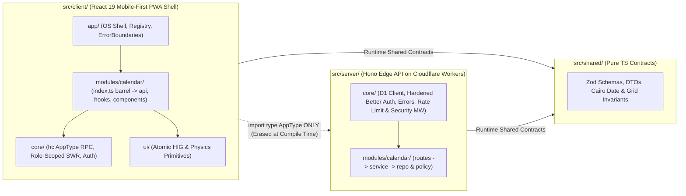
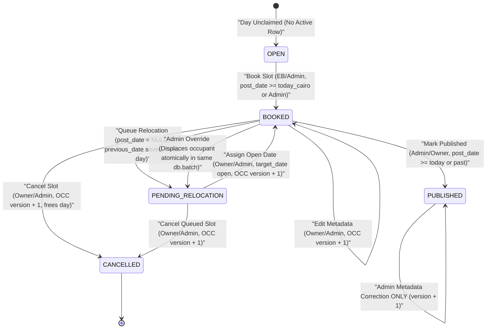
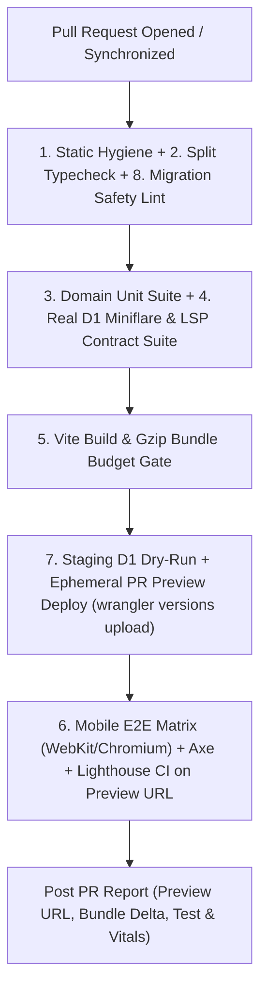

# NVMSA-RFC-001: NVMSA OS — Modular Platform & Module 1 (Content Calendar) Master Specification

| Field | Value |
| :--- | :--- |
| **Document ID** | `NVMSA-RFC-001` |
| **Status** | `Ready for Executive & Principal QA Sign-Off` |
| **Author** | Principal Software Engineer |
| **Review Board** | CEO (Product & Craft) · CTO (Architecture & Security) · Principal QA Engineer (Reliability & FMEA) |
| **Target Platform** | Mobile-First Progressive Web App (iOS Safari, Android Chrome, Desktop Web) |
| **Core Stack** | Cloudflare Workers (Static Assets), Hono, React 19 + Vite, Tailwind CSS v4, Cloudflare D1 (SQLite), Drizzle ORM, Better Auth |
| **Primary Timezone** | `Africa/Cairo` (EET `UTC+2` / EEST `UTC+3`) |
| **Baseline Commit** | `f185f62` (`main`) |
| **Spec Branch** | `docs/nvmsa-os-master-spec` |

---

## Table of Contents

1. [Executive Summary, Product Philosophy & v1.0 Codebase Audit](#1-executive-summary-product-philosophy--v10-codebase-audit)
2. [System Architecture & Mechanically Enforced SOLID Matrix](#2-system-architecture--mechanically-enforced-solid-matrix)
3. [Domain Model, Formal State Machine, Schema Evolution & Concurrency](#3-domain-model-formal-state-machine-schema-evolution--concurrency)
4. [API Contract, Security & STRIDE Threat Model](#4-api-contract-security--stride-threat-model)
5. [Human Interface Guidelines, Motion Physics & 16-Item Craft Catalog](#5-human-interface-guidelines-motion-physics--16-item-craft-catalog)
6. [Offline Resilience, Caching & Quantitative Performance Budgets](#6-offline-resilience-caching--quantitative-performance-budgets)
7. [Principal QA War Room: 25-Scenario FMEA & Adversarial Edge-Case Matrix](#7-principal-qa-war-room-25-scenario-fmea--adversarial-edge-case-matrix)
8. [Verification & 4-Layer Test Strategy](#8-verification--4-layer-test-strategy)
9. [Solid Branch Builds, 8-Stage CI/CD & Release Engineering](#9-solid-branch-builds-8-stage-cicd--release-engineering)
10. [Implementation Roadmap, ADRs & Executive Review Sign-Off Checklist](#10-implementation-roadmap-adrs--executive-review-sign-off-checklist)

---

## 1. Executive Summary, Product Philosophy & v1.0 Codebase Audit

**NVMSA OS** is the modular operational backbone of **New Valley Medical Students' Association (NVMSA)**. Rather than shipping disposable single-purpose tools that fracture member attention every academic term, NVMSA OS is architected as a single installable PWA shell backed by a **Modular Monolith** where operational workflows plug in as isolated vertical modules (`calendar` in v1.0, followed by `activities` in v1.x and `recruitment` / member hub in v2.0).

> **ARB Terminology & Org-Unit Reconciliation Note**: Previous draft memos referenced *"Veterinary"* and placeholder unit acronyms (*SCOURGE*, *BNSD*). Ground truth in the repository (`README.md`, `index.html`, `src/shared/constants/committees.ts`, `src/shared/constants/divisions.ts`) is **New Valley Medical Students' Association (NVMSA)** with IFMSA Standing Committees (`SCOPH`, `SCORA`, `SCORP`, `SCOME`, `SCOPE`, `SCORE`) and Support Divisions (`PNSDD`, `PSDD`, `CBDD`, `FSDD`, `EB`). Under `RFC-001`, all committees and divisions move out of hardcoded frontend arrays into the extensible D1 `org_units` table (Section 3.1), seeded with NVMSA's 11 active medical units while allowing future units without code deploys.

Module 1 (**Content Calendar**) solves an acute distribution and coordination bottleneck across standing committees and support divisions: enforcing a strict **1-post-per-day** reach policy with zero double-booking, instant mobile availability checks for officers, creator-locked Executive Board (EB) scheduling, and a first-class **Pending Relocation** workflow.

### 1.1 North Star Quality Bars

1. **Zero-Friction Distribution**: Officers open a pinned link and see live availability in **< 500ms** (warm SWR) / **≤ 1.2s** (cold Egyptian 4G) with zero account creation and zero App Store friction.
2. **Native-Grade Physicality**: Every interaction—month swipes, bottom-sheet detents, lock confirmations, and conflict rollbacks—runs on GPU-composited spring physics at **60fps–120fps** (`≤ 16.67ms` / `≤ 8.33ms` per frame) with **0.00 Cumulative Layout Shift (CLS)**.
3. **Database-Guaranteed Truth**: Application UI is optimistic; the database is authoritative. No race condition, flaky mobile retry, or unauthorized request can violate the 1-post-per-day invariant or overwrite another EB member's slot.

### 1.2 v1.0 Codebase Audit & RFC-001 Delta Ledger (Verified Against `f185f62`)

Reviewing commit `f185f62` line-by-line identifies the exact security, concurrency, schema, CI, and UX gaps separating v1.0 from `NVMSA-RFC-001` production standards:

| ID | Severity | Area | Verified v1.0 Evidence | Target RFC-001 Resolution |
| :--- | :--- | :--- | :--- | :--- |
| `P0-SEC-01` | **P0** | Auth / Privilege Escalation | `src/server/core/auth/auth.ts:43-55` configures `additionalFields.role` & `entityCode` without `input: false`; public sign-up is open. | Disable public self-signup (invite-only provisioning via Admin tokens) and enforce `input: false` on privileged fields. |
| `P0-SEC-02` | **P0** | Client Cache Leak | `src/client/core/auth/useSession.tsx:86-97` never clears `nvmsa_os_swr:*` on `signOut()`; `useCalendarMonth.ts:26` passes unscoped `initialData` without `initialDataUpdatedAt`. | Partition SWR keys by auth scope (`public` vs `<role>:<userId>`), wire `initialDataUpdatedAt`, and wipe all caches on auth transitions. |
| `P0-DATA-01` | **P0** | DB Atomicity / Audit Trail | `calendar.service.ts:133-160, 184-212, 238-262, 280-306, 326-346` runs slot writes and `appendAuditLog()` sequentially outside `db.batch()`. | Commit slot write, audit log (`diff_json`), and `idempotency_keys` atomically inside one D1 `db.batch()`. |
| `P0-DATA-02` | **P0** | OCC & Idempotency | `cancelSlot()` (`calendar.service.ts:326-329`) omits `expectedVersion`; write endpoints lack `Idempotency-Key`; OCC returns `409` instead of `412`. | Enforce `Idempotency-Key` (24h D1 store) across all writes; require `expectedVersion` on all mutations including `DELETE`, returning `412 Precondition Failed` on version drift. |
| `P1-SCHEMA-01` | **P1** | Schema Alignment | `calendar_slots` lacks `org_units` FK, `PUBLISHED` status, `asset_url`, `previous_date`, nullable `post_date` `CHECK` constraint, and `idempotency_keys`. | Execute Expand-and-Contract migration `0002_rfc001_expand.sql` evolving v1.0 rows losslessly into the RFC-001 schema (Section 3.1). |
| `P1-FUNC-01` | **P1** | Cross-Month Cache Drift | `DayCell.tsx:18` selects `!cell.inCurrentMonth` dates while `useOptimisticBooking(month)` invalidates only the *viewed* month; `RelocationDrawer.tsx:53` checks only current month's `bookedDates`. | Return `{ affectedMonths }` from mutations, invalidate all affected month caches + Relocation Queue atomically, and fetch cross-month relocations/availability directly. |
| `P1-FUNC-02` | **P1** | Date & Grid Stability | `useCalendarMonth.ts:20` freezes `todayCairo` via `useMemo(..., [])`; `YearMonthSchema` (`calendar.schema.ts:8-10`) accepts `2026-00`/`2026-99`; `buildMonthGrid` (`date.ts:83-109`) flips between 35 and 42 cells. | Add `useCairoClock()` midnight timer + `visibilitychange` refresh; tighten `YearMonthSchema` (`01`–`12`); standardize `buildMonthGrid` to **Fixed 42-Cell (6×7)** layout (`CLS = 0.00`). |
| `P1-FUNC-03` | **P1** | Missing Documented Flows | `README.md:69` promises Admin `Override slot` and `calendar.routes.ts:38-43` exposes `GET /slots/:id/history`, but neither has working end-to-end UI or atomic override logic. | Ship atomic `ADMIN_OVERRIDE` batch command, `PUBLISHED` transition, Relocation Placement Mode, and interactive Audit History drawer. |
| `P1-PWA-01` | **P1** | Service Worker Fragility | `public/sw.js:20-34` caches non-2xx/opaque responses, crashes offline on `/calendar` deep reloads, and executes blind `self.skipWaiting()`. | Upgrade to Workbox / safe caching (`res.ok && res.type === 'basic'`), SPA navigation fallback, and calm `"New version ready — Refresh"` update prompt. |
| `P1-SEC-03` | **P1** | Edge Hardening | `auth.ts:30` falls back to `localhost:5173`; `session.ts:61-63` silently swallows errors; missing CSP/Origin/rate-limit middleware. | Fail startup if prod `BETTER_AUTH_URL` missing; log auth faults; enforce `Origin` check, CSP, `X-Frame-Options: DENY`, `nosniff`, and edge rate limits. |
| `P1-BUILD-01` | **P1** | Supply-Chain & CI Gaps | `package.json` lacks `"packageManager"`; `pnpm-lock.yaml` fails `ERR_PNPM_MINIMUM_RELEASE_AGE_VIOLATION` on 6 recently published entries; `ci.yml` has no Miniflare D1, Playwright, or PR previews. | Pin `"packageManager"`, align `pnpm-workspace.yaml` 24h quarantine rules, and deploy the 8-stage CI + ephemeral PR preview pipeline (Section 9). |
| `P1-UX-01..04` | **P1** | Motion, Touch, BiDi & a11y | `BottomSheet.tsx` snaps abruptly with a dead drag pill, no detents, no focus trap/scroll lock, no `visualViewport` keyboard offset; `index.css` is 18 lines; no swipe pager; `text-slate-300` `"Open"` label fails AA contrast; missing `dir="auto"` and `prefers-reduced-motion`. | Implement full Section 5 motion physics engine, 16-item choreography catalog, `dir="auto"` BiDi safety, WCAG AA/AAA contrast, roving-tabindex grid, and reduced-motion crossfades. |

---

## 2. System Architecture & Mechanically Enforced SOLID Matrix

NVMSA OS rejects distributed microservices (unnecessary network hops, operational overhead) and heavy poly-package monorepos (build pipeline tax) in favor of a **Single-Repo Modular Monolith** with compile-time and AST-enforced boundaries.

### 2.1 Strict Dependency Topology



*Strict Boundary Rule*: Cross-boundary client-to-server imports are permitted **only** as `import type { AppType } from '@server/index'`. Any runtime server import into `src/client/` or React/Hono/Drizzle import into `src/shared/` fails CI immediately.

### 2.2 Mechanically Enforced SOLID Matrix

We do not rely on code review willpower to uphold SOLID; boundaries are enforced mechanically by `tsconfig.app.json`, `tsconfig.worker.json`, and ESLint `no-restricted-imports` rules in CI:

| Principle | Concrete Architectural Mechanism | Violation Caught By |
| :--- | :--- | :--- |
| **Single Responsibility (SRP)** | Backend vertical slice strictly separates HTTP (`routes`), orchestration (`service`), authorization (`policy`), and SQL (`repository`). Frontend separates data fetching (`api/`), state/gesture logic (`hooks/`), and pure rendering (`components/`). | PR Review + Unit Test isolation |
| **Open / Closed (OCP)** | Adding Module 2 (e.g., `activities`, `recruitment`) requires creating a new slice in `server/modules/` and `client/modules/` and appending one declarative descriptor (with `enabled: boolean` dark-launch toggle, `preloadChunk`, and isolated `<ErrorBoundary>`) to `OS_MODULES` in `modules.registry.ts`. Existing modules remain untouched. | Module barrel lint rule (`@client/modules/*/*`) |
| **Liskov Substitution (LSP)** | `CalendarService` depends exclusively on `ISlotRepository`. Production binds `D1SlotRepository`; unit tests bind `InMemorySlotRepository` with identical uniqueness, OCC `version`, atomic batch, and audit semantics. | **Shared Repository Contract Test Suite** (Section 8) |
| **Interface Segregation (ISP)** | Read models (`PublicSlotView` stripped of internal notes, creator ID, audit/version metadata) are segregated from privileged reads (`ManagedSlotView`) and write commands (`BookSlotCommand`, `RelocateSlotCommand`, `QueueRelocationCommand`, `AdminOverrideCommand`). | Separate Zod schemas in `src/shared/schemas/` |
| **Dependency Inversion (DIP)** | High-level domain services never import `drizzle-orm` or `D1Database`. A thin per-request composition factory in `routes` injects concrete `D1SlotRepository` and `CalendarPolicy` into `CalendarService`. | `tsconfig.worker.json` + ESLint import restriction |

---

## 3. Domain Model, Formal State Machine, Schema Evolution & Concurrency

### 3.1 Canonical Database Schema (Cloudflare D1 / SQLite)

All primary keys use lexicographically sortable **UUIDv7** (or ULID) strings for clean B-tree index locality. All timestamps are stored as ISO-8601 UTC strings (`TEXT`), while calendar dates are stored strictly as timezone-free calendar strings (`YYYY-MM-DD`).

```sql
-- 1. Organization Units (Extensible without code deploys; seeded with NVMSA's 11 units)
CREATE TABLE org_units (
  id           TEXT PRIMARY KEY,              -- e.g., 'scoph', 'pnsdd'
  code         TEXT NOT NULL UNIQUE,          -- e.g., 'SCOPH', 'PNSDD'
  name         TEXT NOT NULL,
  kind         TEXT NOT NULL CHECK (kind IN ('COMMITTEE', 'DIVISION', 'BOARD')),
  accent_token TEXT NOT NULL,                 -- Design system color token key
  is_active    INTEGER NOT NULL DEFAULT 1,
  created_at   TEXT NOT NULL
);

-- 2. Content Calendar Slots (Module 1 Core Table)
CREATE TABLE post_slots (
  id                TEXT PRIMARY KEY,
  post_date         TEXT,                     -- 'YYYY-MM-DD' when BOOKED/PUBLISHED; NULL when PENDING_RELOCATION
  status            TEXT NOT NULL CHECK (status IN ('BOOKED', 'PENDING_RELOCATION', 'PUBLISHED', 'CANCELLED')),
  org_unit_id       TEXT NOT NULL REFERENCES org_units(id),
  content_type      TEXT NOT NULL CHECK (content_type IN ('POST', 'PHOTO', 'REEL', 'COLLAB', 'STORY_CAMPAIGN')),
  title             TEXT NOT NULL,
  notes             TEXT,
  asset_url         TEXT,                     -- Validated https:// Canva / Google Drive link
  relocation_reason TEXT,                     -- Populated when moved to PENDING_RELOCATION or ADMIN_OVERRIDE
  previous_date     TEXT,                     -- Last booked date for context in Relocation Queue
  created_by_id     TEXT NOT NULL,            -- Better Auth user.id
  created_by_name   TEXT NOT NULL,            -- Denormalized snapshot (survives user deactivation)
  version           INTEGER NOT NULL DEFAULT 1, -- Optimistic Concurrency Control (OCC)
  created_at        TEXT NOT NULL,
  updated_at        TEXT NOT NULL,

  -- Invariant: BOOKED/PUBLISHED MUST have a post_date; PENDING_RELOCATION MUST have NULL post_date
  CHECK (
    (status = 'BOOKED' AND post_date IS NOT NULL) OR
    (status = 'PUBLISHED' AND post_date IS NOT NULL) OR
    (status = 'PENDING_RELOCATION' AND post_date IS NULL) OR
    (status = 'CANCELLED')
  )
);

-- HARD INVARIANT: At most ONE active BOOKED or PUBLISHED post per calendar day.
CREATE UNIQUE INDEX uq_active_post_date
  ON post_slots(post_date)
  WHERE status IN ('BOOKED', 'PUBLISHED');

-- Fast month range queries, queue retrieval, and creator lookups
CREATE INDEX idx_post_slots_status_date ON post_slots(status, post_date);
CREATE INDEX idx_post_slots_creator ON post_slots(created_by_id, status);

-- 3. Idempotency Store (Prevents duplicate mutations on flaky 4G retries)
CREATE TABLE idempotency_keys (
  key           TEXT NOT NULL,
  user_id       TEXT NOT NULL,
  route         TEXT NOT NULL,
  request_hash  TEXT NOT NULL,
  response_code INTEGER NOT NULL,
  response_body TEXT NOT NULL,
  created_at    TEXT NOT NULL,
  expires_at    TEXT NOT NULL,                -- TTL: 24 hours, pruned periodically
  PRIMARY KEY (key, user_id, route)
);

CREATE INDEX idx_idempotency_expires ON idempotency_keys(expires_at);

-- 4. Append-Only Audit Log (Accountability for Admin overrides & EB edits)
CREATE TABLE slot_audit_log (
  id          TEXT PRIMARY KEY,
  slot_id     TEXT NOT NULL REFERENCES post_slots(id),
  actor_id    TEXT NOT NULL,
  actor_name  TEXT NOT NULL,
  actor_role  TEXT NOT NULL,
  action      TEXT NOT NULL,                  -- BOOKED, UPDATED, QUEUED_RELOCATION, RELOCATED, PUBLISHED, CANCELLED, ADMIN_OVERRIDE
  diff_json   TEXT NOT NULL,                  -- Structured { before, after, reason }
  created_at  TEXT NOT NULL
);

CREATE INDEX idx_slot_audit_slot_time ON slot_audit_log(slot_id, created_at DESC);
```

#### Zero-Downtime Bridge From v1.0 (`0000` / `0001`) to `RFC-001` Schema
Because v1.0 already deployed `calendar_slots` and `calendar_slot_audit_logs` to D1 (`wrangler.jsonc`), migration `drizzle/0002_rfc001_expand.sql` MUST preserve every existing row rather than dropping tables:
1. Create `org_units` and seed all 11 existing NVMSA entities (`SCOPH`, `SCORA`, `SCORP`, `SCOME`, `SCOPE`, `SCORE`, `PNSDD`, `PSDD`, `CBDD`, `FSDD`, `EB`).
2. Create `post_slots`, `idempotency_keys`, and `slot_audit_log`, then backfill from `calendar_slots` (mapping `'booked' -> 'BOOKED'`, `'relocation_queue' -> 'PENDING_RELOCATION'` with `previous_date = post_date` & `post_date = NULL`, `'cancelled' -> 'CANCELLED'`, `'poster' -> 'POST'`, `'carousel' -> 'PHOTO'`, `'reel' -> 'REEL'`, `'story' -> 'STORY_CAMPAIGN'`, `'announcement' -> 'COLLAB'`) and `calendar_slot_audit_logs` within a single migration script.
3. Retain legacy tables read-only for 48 hours post-cutover (`Expand-and-Contract` Section 9.4) before dropping in a cleanup migration.

### 3.2 Formal Slot State Machine

An **Available / Open** day is an implicit state (no row exists with `status IN ('BOOKED', 'PUBLISHED')` for that `post_date`).



#### Transition Guard Invariants
1. **No Backdating**: Non-admin EB members cannot book or relocate a slot onto a `post_date < today(Africa/Cairo)`.
2. **Atomic Date Release**: Moving a slot from `BOOKED` to `PENDING_RELOCATION` sets `post_date = NULL` and `previous_date = old_post_date` in a single atomic SQL statement (paired with its `slot_audit_log` row inside `db.batch()`), immediately releasing the day for other EB members.
3. **Creator Lock**: Only `slot.created_by_id === actor.id` or `actor.role === 'ADMIN'` may transition or mutate a slot.
4. **Immutable Published History**: Once `PUBLISHED`, only `ADMIN` may correct metadata (`title`, `notes`, `asset_url`); the slot cannot be deleted, queued, or overwritten by new bookings.
5. **Atomic Admin Override (`ADMIN_OVERRIDE`)**: When an Admin overrides an occupied date, `db.batch()` atomically (a) transitions the displaced slot to `PENDING_RELOCATION` (`post_date = NULL`, `previous_date = target_date`, `relocation_reason = "Displaced by Admin: " + reason`, `version + 1`), (b) appends the displaced slot's `ADMIN_OVERRIDE` audit record, (c) inserts or relocates the incoming slot onto `target_date` as `BOOKED`, and (d) logs the incoming slot's audit entry. Zero posts vanish silently.

### 3.3 Three-Layer Concurrency & Consistency Architecture

Mobile users on fluctuating cellular networks generate two classic failure modes: concurrent multi-user collisions and single-user duplicate retries. All state mutations write slot state, audit trail, and idempotency record inside a single Cloudflare D1 `db.batch()`:

1. **Layer 1 — Idempotency (`Idempotency-Key` Header)**: Every mutating client request (`POST`, `PATCH`, `DELETE`) generates a UUIDv4 `Idempotency-Key` per user intent. If a 4G connection drops after D1 commits but before the HTTP response reaches the phone, the client retry returns the cached `201`/`200` response from `idempotency_keys` (verified against `request_hash`; differing payload returns `422 IDEMPOTENCY_CONFLICT`) instead of a false `409 Conflict`.
2. **Layer 2 — Optimistic Concurrency Control (`version`)**: Every `PATCH`, `relocate`, `queue-relocation`, `publish`, and `DELETE` includes `expectedVersion`. SQL executes `UPDATE post_slots SET ..., version = version + 1 WHERE id = ? AND version = ?`. Zero rows affected returns **`412 Precondition Failed`** (`STALE_VERSION`) with current server state, preventing silent lost updates when an Admin and EB member edit or cancel concurrently.
3. **Layer 3 — Hard Uniqueness (`uq_active_post_date`)**: If EB Member A and EB Member B tap `"Lock This Day"` for `2026-12-03` within **10ms** of each other, SQLite's partial unique index rejects the second write with `SQLITE_CONSTRAINT_UNIQUE`. The repository catches this specific error, maps it to `ConflictError` (`409 Conflict`), and attaches the winning slot's `PublicSlotView` summary (plus next open Cairo date) so the losing client updates its UI immediately without an extra round-trip.

### 3.4 Timezone & Calendar Mathematics

- **Rule of Zero Timestamps for Dates**: Never pass `post_date` through `new Date("2026-12-03")` in client local timezone. All calendar grid generation uses integer `(year, month, day)` UTC calendar arithmetic.
- **Cairo Anchor**: `"Today"` is computed exclusively via `Intl.DateTimeFormat('en-CA', { timeZone: 'Africa/Cairo' })` (which yields `YYYY-MM-DD`, accurately handling Egypt's EET `UTC+2` / EEST `UTC+3` DST transitions). An EB member traveling abroad or using a misconfigured device clock still sees the exact NVMSA Cairo schedule day.
- **Midnight & Foreground Sync (`useCairoClock`)**: Client schedules a lightweight timer to `00:00:05 Africa/Cairo` and re-evaluates Cairo `"Today"` on `document.visibilitychange` (`visible`) and `window.focus` so overnight PWA tabs never show yesterday as bookable.
- **Strict Month/Date Schemas**: `YearMonthSchema` validates both format (`/^\d{4}-\d{2}$/`) and real calendar bounds (`01 <= month <= 12`, `2020 <= year <= 2100`), rejecting `2026-00` and `2026-13` at the Zod edge.
- **Fixed 42-Cell (6×7) Grid Invariant**: Every month renders **exactly 42 cells** (6 rows × 7 days, including leading/trailing muted adjacent-month cells). Identical vertical grid height across all 12 months eliminates vertical layout jumps (`CLS = 0.00`) when swiping horizontally between a 28-day February and a 31-day month starting on Saturday.

---

## 4. API Contract, Security & STRIDE Threat Model

All endpoints are served under `/api/v1/calendar/*` via Hono and exported as `AppType` for end-to-end compile-time type safety via `hc<AppType>` (preserving `/api/health` and Better Auth `/api/auth/*` mounted cleanly).

### 4.1 Endpoint Specification

| Method & Path | Role | Headers | Success | Error Codes |
| :--- | :--- | :--- | :--- | :--- |
| `GET /api/v1/calendar/month?ym=YYYY-MM` | Public (`Officer+`) | `If-None-Match` (`ETag`) | `200 OK` / `304 Not Modified` | `400` |
| `GET /api/v1/calendar/relocations` | Public (`Officer+`) | `If-None-Match` | `200 OK` / `304` | `400` |
| `GET /api/v1/calendar/availability?from=&to=` | `EB`, `ADMIN` | — | `200 OK` (`bookedDates[]`) | `400`, `401`, `403` |
| `GET /api/v1/calendar/slots/:id/history` | `EB`, `ADMIN` | — | `200 OK` (`SlotAuditLogEntry[]`) | `401`, `403`, `404` |
| `POST /api/v1/calendar/slots` | `EB`, `ADMIN` | `Idempotency-Key` | `201 Created` (`{ slot, affectedMonths }`) | `400`, `401`, `403`, `409`, `422`, `429` |
| `PATCH /api/v1/calendar/slots/:id` | Owner `EB` / `ADMIN` | `Idempotency-Key` | `200 OK` (`{ slot, affectedMonths }`) | `401`, `403`, `404`, `412`, `422` |
| `POST /api/v1/calendar/slots/:id/queue-relocation` | Owner `EB` / `ADMIN` | `Idempotency-Key` | `200 OK` (`{ slot, affectedMonths }`) | `401`, `403`, `404`, `409`, `412` |
| `POST /api/v1/calendar/slots/:id/relocate` | Owner `EB` / `ADMIN` | `Idempotency-Key` | `200 OK` (`{ slot, affectedMonths }`) | `401`, `403`, `404`, `409`, `412`, `422` |
| `POST /api/v1/calendar/slots/:id/publish` | Owner `EB` / `ADMIN` | `Idempotency-Key` | `200 OK` (`{ slot, affectedMonths }`) | `401`, `403`, `404`, `412` |
| `POST /api/v1/calendar/slots/override` | `ADMIN` | `Idempotency-Key` | `200 OK` / `201 Created` (`{ slot, displacedSlot, affectedMonths }`) | `400`, `401`, `403`, `412`, `422` |
| `DELETE /api/v1/calendar/slots/:id` | Owner `EB` / `ADMIN` | `Idempotency-Key` | `200 OK` (`Soft Cancel` + `affectedMonths`) | `401`, `403`, `404`, `412` |

### 4.2 Role & Permission Matrix

| Capability | Officer (Unauthenticated) | EB Member (Authenticated) | Super Admin (PNSDD Head / Pres.) |
| :--- | :---: | :---: | :---: |
| View Free / Booked / Relocation Queue | Yes | Yes | Yes |
| See Org Unit, Format, Title, Booked-By Name | Yes | Yes | Yes |
| See Internal EB Notes / Asset Links / Audit History | **No** (Stripped by `PublicSlotView`) | Yes | Yes |
| Book an Open Day (`post_date >= today_cairo`) | No | Yes | Yes |
| Edit / Queue Relocation / Publish / Cancel Own Slot | No | Yes | Yes |
| Edit / Override Another EB's Slot / Backdate | No | **Hard Blocked (`403`)** | Yes (Atomic `ADMIN_OVERRIDE` logged) |
| Manage Org Units & Invite / Soft-Deactivate EB Accounts | No | No | Yes |

### 4.3 Security Threat Model (STRIDE)

1. **Spoofing / Public Registration Abuse**: Public self-sign-up is disabled in Better Auth. EB accounts are provisioned exclusively via Admin invite links with single-use expiring tokens, and `user.additionalFields.role` + `entityCode` explicitly configure `input: false` in `auth.ts`. Production startup throws hard if `BETTER_AUTH_URL` is missing or non-HTTPS; `x-dev-role` impersonation remains double-gated (`APP_ENV === 'development' && ALLOW_DEV_IMPERSONATION === 'true'`) and ignored otherwise.
2. **Tampering / IDOR (Broken Object-Level Auth)**: Authorization is enforced twice—first in `CalendarPolicy.assertCanMutate(actor, slot)` and second via defensive SQL `WHERE` clauses (`AND version = ?`). Attempting to mutate another EB's slot returns `403 Forbidden` with structured error code `SLOT_OWNERSHIP_VIOLATION`.
3. **CSRF & Session Theft**: Better Auth sessions use `HttpOnly; Secure; SameSite=Lax` cookies; mutating endpoints verify `Origin` matches the canonical app origin (`trustedOrigins`).
4. **Injection & XSS**: Drizzle parameterized queries eliminate SQL injection. Strict `Content-Security-Policy` headers (`default-src 'self'; script-src 'self'; object-src 'none'; frame-ancestors 'none'`) + `X-Content-Type-Options: nosniff` + `X-Frame-Options: DENY` forbid inline scripts; `asset_url` is strictly validated by Zod to accept `https://` URLs only (rejecting `javascript:` or `data:` schemes).
5. **Information Disclosure (Shared Devices)**: Client SWR cache keys are strictly partitioned by auth scope (`nvmsa_os_swr:v2:<scope>:month:<YYYY-MM>`), hydrated with `initialDataUpdatedAt`, and **synchronously purged** on `signOut()`, `signIn()`, and `switchDevPersona()`. Server auth failures in `sessionMiddleware` emit structured `auth_session_error` logs instead of failing silently.
6. **Denial of Service / Free Tier Exhaustion**: Cloudflare Workers Rate Limiting caps `/api/auth/*` at **`10 req/min/IP`** and calendar mutations at **`30 req/min/user`**. Read routes emit strong `ETag` headers so revalidation returns lightweight `304 Not Modified`.

---

## 5. Human Interface Guidelines, Motion Physics & 16-Item Craft Catalog

This section defines the sensory, physical, and ergonomic standards so NVMSA OS feels indistinguishable from a first-party native iOS/Android utility.

### 5.1 Ergonomics, Layout, BiDi & Contrast

- **Dynamic Viewport & Safe Areas**: Root shell uses `min-height: 100dvh`, `viewport-fit=cover`, and explicit safe-area padding (`env(safe-area-inset-top)`, `env(safe-area-inset-bottom)`) so fixed bottom navigation and sheets never collide with the iPhone Home Indicator or Dynamic Island.
- **Touch Targets**: Every interactive day cell and action control enforces a minimum hit area of **`44×44 pt`** (Apple HIG) / **`48×48 dp`** (Android Material), even when the visual badge inside the cell is compact.
- **Visual State Semantics (Color + Shape + Icon — Never Color Alone)**:
  - **Available / Open Day**: Clean neutral surface, crisp tabular numeral (`font-variant-numeric: tabular-nums`), subtle emerald dot indicator (`≥ 3:1` contrast) in EB Booking Mode and `text-slate-500` (`#64748b`, `4.76:1` contrast — fixing v1.0's unreadable `text-slate-300` `"Open"` label).
  - **Booked Day (Locked)**: High-contrast crimson/rose or committee-tinted accent fill, crisp `1px` border, compact org-unit pill (e.g., `SCOME`, `SCOPH`), and tiny **lock glyph** (non-owners) or **edit-dot** (owner) so colorblind users distinguish state immediately.
  - **Published Day**: Solid emerald check glyph beside the committee pill.
  - **Today Ring**: High-contrast primary accent ring around the day numeral.
  - **Pending Relocation Badge**: Persistent amber pill in the top header displaying live queue count (`2 Pending`) with subtle breathing pulse only when `count > 0`.
- **BiDi & Arabic Readiness**: Because NVMSA members mix English committee acronyms with Arabic campaign titles, all user-authored text inputs and display nodes apply `dir="auto"` and `unicode-bidi: plaintext`, with `line-clamp-2`, `min-w-0`, and CSS logical utilities (`ms-`, `pe-`, `text-start`) + Unicode-grapheme-aware **120-character cap** so long Arabic titles never fracture `375px` grid geometry.
- **Contrast Compliance**: Primary text meets **WCAG AAA (`≥ 7:1`)**; all 11 org-unit badges, status indicators, and muted labels pass **WCAG AA (`≥ 4.5:1` text / `≥ 3:1` UI graphics)** in Light and Dark themes (automated contrast test covering every `org_units` palette token, upgrading `CBDD` text to `text-amber-950` on `bg-amber-100`).

### 5.2 Physics-Based Motion Language

Linear or generic CSS `ease-in-out` curves feel mechanical and web-like. NVMSA OS runs on `motion/react` (`<LazyMotion features={loadDomMax} strict>` loaded asynchronously to protect initial bundle size) using critically damped and underdamped spring physics governed by the damped harmonic oscillator model:

```text
F = -k * x - c * v        damping ratio (zeta) = c / (2 * sqrt(k * m))
```

where `k` is stiffness, `c` is damping, `m` is normalized mass, and `zeta` (`ζ`) determines overshoot vs. crisp settling.

#### Standardized Motion Tokens (`src/client/core/motion/tokens.ts`)

| Token | Spring Parameters (`stiffness / damping / mass`) | Damping Ratio (`ζ`) | Approx. Settle | Feel & Use Case |
| :--- | :--- | :---: | :---: | :--- |
| `spring.snappy` | `k = 520, c = 36, m = 0.8` | `~0.88` (near-critical) | `~180 ms` | Tactile press feedback, `DayCell` selection, segmented `layoutId` pill, filter chips |
| `spring.sheet` | `k = 380, c = 34, m = 1.0` | `~0.87` (near-critical) | `~260 ms` | Bottom sheet presentation, detent snapping, `MobileShell` depth scale (`0.985`), drag release |
| `spring.swipe` | `k = 300, c = 32, m = 1.0` | `~0.92` (critically smooth) | `~300 ms` | Horizontal 42-cell month carousel swipe & momentum settle |
| `spring.gentle` | `k = 240, c = 28, m = 1.0` | `~0.90` | `~340 ms` | Relocation drawer expand, subtle crossfades, odometer queue counters, route transitions |
| `spring.bouncy` | `k = 460, c = 22, m = 0.9` | `~0.54` (controlled underdamped) | `~320 ms` | Slot lock-in radial confirmation pop, SVG check draw, Dynamic-Island toast entry |
| `spring.reject` | Horizontal damped keyframes (`[0, -10, 9, -6, 3, 0]`, `k = 680, c = 18, m = 0.7`) | `~0.41` (underdamped oscillation) | `~280 ms` | `409 Conflict` rollback shake, `412` stale edit warning, invalid action wobble |

#### Hard Rendering Rules (Zero-Jank Guarantee)
1. **GPU-Composited Properties Only**: Animations may only mutate `transform` (`translate3d`, `scale`, `rotate`), `opacity`, and hardware-accelerated `clip-path`. Animating `height`, `top`, `left`, `margin`, or `width` frame-by-frame is **strictly forbidden** (use FLIP `layout` transforms only for container disclosures). Zero React `setState()` inside `onPointerMove` / `useDrag` loops—mutate `MotionValue` instances directly so JavaScript frame time stays `< 2.5ms`.
2. **Interruptibility**: Every gesture-driven animation (`BottomSheet`, `MonthPager`, `PullToRefresh`) tracks pointer velocity (`vx`, `vy`) and passes it directly into the spring integrator. Grabbing a dismissing sheet mid-flight catches it seamlessly without snapping.
3. **Reduced Motion Compliance**: Globally wrapped in `<MotionConfig reducedMotion="user">` + `@media (prefers-reduced-motion: reduce)`. When active, spatial translations, bounces, horizontal shakes, radial bursts, and haptic `vibrate()` calls degrade automatically to crisp **`150 ms` opacity crossfades** while preserving full visual state clarity.

### 5.3 Complete 16-Item Interaction & Animation Choreography Catalog

| # | User Journey / Feature | Gesture / Trigger | Visual & Motion Choreography | Haptic / Sensory Feedback |
| :---: | :--- | :--- | :--- | :--- |
| **1** | **Cold / Warm PWA Launch** | Tap Home Screen icon | App shell renders immediately from SW cache; current month hydrates synchronously from role-scoped `localStorage` SWR snapshot (`0 ms` perceived blank screen). Background fetch reconciles diff with a quiet `150 ms` crossfade—zero full-page spinners. | None (silent clarity) |
| **2** | **Month Navigation & Prefetch** | Horizontal finger swipe across 42-cell grid or header chevrons | 1:1 finger tracking (`translateX`) with `0.25` rubber-band resistance at bounds. Release past `350 px/s` or `30%` grid width commits via `spring.swipe` while month heading cross-slides vertically (`±14px`). Adjacent months (`M-1`, `M+1`) prefetch on idle for zero-wait swipes. | Light tick on month snap (`vibrate(8)`) |
| **3** | **Day Cell Tap & Shell Depth** | Tap any day cell (incl. overflow adjacent days) | Press scales cell to `0.95` (`spring.snappy`). On release, selected cell anchors `layoutId="selected-day-ring"`, `BottomSheet` rises via `spring.sheet`, and `MobileShell` recedes smoothly (`rgba(0,0,0,0.32)` scrim, `scale(0.985)`, top radius morph `16px`). Tapping overflow cell routes mutation & auto-pans to that cell's month. | Light tap (`vibrate(6)`) |
| **4** | **Optimistic Slot Lock Celebration** | EB taps `"Lock This Day"` | Submit button morphs into compact check glyph; sheet dismisses smoothly; target day cell executes white-to-committee radial fill morph, lock-badge scale-in (`0.6 -> 1.0`, `spring.bouncy`), and 6 subtle GPU committee-tinted SVG radial sparks (`360ms`). | Success double-pulse (`vibrate([10, 30, 12])`) |
| **5** | **409 Conflict Rollback** | Simultaneous booking rejected by D1 | Target cell executes `spring.reject` horizontal micro-shake, smoothly reconciles to the winning EB's slot details (returned directly in 409 body), drops a top pill toast (`"Just claimed by [EB Name] for [Unit]"`), and offers a one-tap `"Jump to next open day"` chip. | Error pattern (`vibrate([25, 40, 25])`) |
| **6** | **Non-Owner Locked Inspection** | EB Member B taps EB Member A's locked day | Opens read-only Inspection Sheet clearly displaying `"Locked by [EB Member A]"` with one-tap **`"Copy Slot Info"`** and **`"Message on WhatsApp"`** helpers instead of dead buttons. Restricted action taps trigger lock-icon `spring.reject` wobble. | Subtle warning recoil |
| **7** | **Two-Step Relocation Placement Mode** | Owner taps `"Move to Relocation Queue"` -> later taps `"Assign New Day"` | **Step 1**: Cell clears to open while header Pending badge pops (`1.0 -> 1.18 -> 1.0` + odometer digit roll). **Step 2**: Tapping `"Assign New Day"` activates **Relocation Placement Mode**—a sticky top banner pins (`"Tap any open day for [SCOME Reel]"`), booked days dim to `opacity: 0.38`, open days gently pulse; tapping any open day across any swiped month locks it in one tap! | Tactile confirmation on release and placement |
| **8** | **Two-Detent Bottom Sheet Drag** | Vertical drag on sheet handle / header | Supports **compact** (inspect) and **expanded** (form/history) detents. Dragging past top detent applies logarithmic rubber-band stretch; scroll-vs-drag arbitrator allows internal scroll when `scrollTop > 0` and dismisses on downward flick (`velocity > 450 px/s` or `> 30%` height). | Snap tick on detent cross |
| **9** | **Grid ↔ Agenda Morph** | Tap `Grid` / `Agenda` segmented toggle | Segmented thumb glides across track via `layoutId="calendar-view-pill"` (`spring.snappy`). `AnimatePresence` cross-translates Grid (`scale 0.97`) and Agenda rows (staggered `20ms` capped at 8 visible rows). | Light selection click |
| **10** | **Fluid Org-Unit Filter Ribbon** | Tap `All` or any of the 11 NVMSA entities | Active pill glides across chips via `layoutId="entity-filter-pill"` tinted to unit accent color, auto-centering scrolled chip with CSS edge fade masks; non-matching calendar cells softly dim (`opacity: 0.28, saturate: 0.4`) preserving busy-month context. | Subtle tactile snap |
| **11** | **Inline Confirm & Relocate Disclosures** | Tap `"Cancel Slot"` or `"Move to Queue"` inside sheet | Action bar morphs smoothly via `AnimatePresence mode="wait"` + FLIP `layout` without jarring sheet height jumps. | None |
| **12** | **Dynamic-Island Toast Stack** | Success, error, or Undo event | Floating pill springs into view (`spring.bouncy`), stacks up to 3 items (`scale(1 - i*0.04)`), supports horizontal/down swipe dismiss, GPU `scaleX` timer bar pausing on hold, and 4s `"Undo"` action where permitted. | Mirrors tone |
| **13** | **Bottom Navigation & Route Morph** | Tap `Calendar` / `Activities` / `Members` | Tab icon elevates (`scale(1.08)`) over shared `layoutId="bottom-nav-pill"` capsule; `pointerdown` preloads lazy chunk so `<Outlet />` cross-fades cleanly without loading stalls. | Soft navigation tap |
| **14** | **Today Sonar & Homing** | Current month view or tap `"Today"` | Current Cairo date displays a subtle concentric sonar ring (`scale 1 -> 1.6`, pausing when backgrounded). Tapping `"Today"` from another month pans horizontally along time axis and briefly flashes a homing ring. | Light tick on return |
| **15** | **42-Cell Shimmer Skeleton & Standalone Pull-to-Refresh** | Cold empty cache OR downward pull at `scrollY = 0` in PWA | Exact 42-cell skeleton preserves `0.00` CLS (`160ms` fade to hydrated grid). In standalone PWA mode, downward pull draws an elastic circular spinner arc (`pathLength 0 -> 1`) triggering live refresh cleanly. | Refresh snap tick |
| **16** | **Audit History Timeline Drawer & Warm Empty States** | Tap `"History (N)"` in sheet OR empty queue/agenda | Unfolds vertical audit rail (`booked -> updated -> queued -> relocated / admin_displaced -> published`) with structured `diff_json` pills. Empty states feature calm `< 1.5 KB` inline SVG illustrations + committee-aware guidance. | None |

### 5.4 iOS Safari Keyboard Resilience & Keyboard Grid Accessibility

- **Virtual Keyboard Handling**: `BottomSheet` subscribes to `window.visualViewport` `resize` and `scroll` events, smoothly adjusting `paddingBottom` / vertical translation so sticky primary CTAs (`"Lock Day"`, `"Save Changes"`) stay visible directly above the iOS software keyboard without page jump.
- **Background Scroll Lock & Focus Trap**: While any sheet is open, `MobileShell` scroll is locked (`overscroll-behavior: contain` + touch-move containment) so iOS Safari never rubber-bands the document behind the sheet; Tab navigation is trapped inside the dialog, `Escape` closes the topmost sheet only, and focus returns cleanly to the exact originating `DayCell`.
- **Roving Tabindex & Screen Readers**: Inside the 42-cell grid, `ArrowRight`/`ArrowLeft` traverse `±1` day, `ArrowDown`/`ArrowUp` traverse `±7` days, `Home`/`End` jump week bounds, `PageUp`/`PageDown` switch months, and `Enter`/`Space` open the sheet. Every `DayCell` exposes a descriptive `aria-label` (e.g., `"Thursday, December 3, 2026 — Locked by SCOME: OSCE Prep Carousel"` or `"Friday, December 4, 2026 — Open slot"`), backed by polite/assertive `aria-live` status regions.

---

## 6. Offline Resilience, Caching & Quantitative Performance Budgets

### 6.1 Sync & Cache Architecture

- **App Shell (Workbox / Hardened SW v2)**: Precaches static shell via Workbox (`vite-plugin-pwa`, prompt-based non-disruptive update lifecycle) OR hardened `public/sw.js` that caches **only** `GET` same-origin responses with `res.ok === true && res.type === 'basic'`, serves cached `/index.html` fallback for offline `navigate` requests (`/calendar`, `/activities`), and offers a calm `"New version of NVMSA OS ready — Refresh"` toast without forcefully interrupting an active form mid-type.
- **Data Layer (Role-Scoped SWR + Revalidation Triggers)**:
  - Keys partitioned strictly by auth scope (`nvmsa_os_swr:v2:<scope>:month:<YYYY-MM>` + `relocations`), stamped with `updatedAt` for TanStack Query `initialDataUpdatedAt`, and purged synchronously on `signIn()` / `signOut()` / `switchDevPersona()`.
  - Automatic silent revalidation fires on: (a) initial mount, (b) `visibilitychange` when returning from background/WhatsApp, (c) `online` network restoration event, and (d) `BroadcastChannel('nvmsa-calendar')` message when another browser tab mutates data.
  - Every mutation returns `affectedMonths` so cross-month relocations invalidate both source and destination months + Relocation Queue atomically.
- **Offline Behavior**: Reading cached months works offline with a quiet amber pill (`"Offline — showing synced schedule from 2m ago"`). Mutations require live server confirmation (never silently queued for hours, which would create misleading false locks); attempting to submit while offline surfaces an actionable retry banner retaining the typed form draft.

### 6.2 Strict Quantitative Performance Budgets

CI fails if production builds exceed size budgets; Playwright performance audits flag regressions against runtime budgets. Budgets are calibrated directly against our measured v1.0 `vite build` output (`100.47 KB` entry JS, `10.71 KB` calendar chunk, `6.51 KB` CSS gzipped):

| Metric | Target Budget (Fail Threshold) | Measurement Condition |
| :--- | :--- | :--- |
| **Initial Entry JS Payload (Client)** | **≤ 108 KB** gzipped (Fail `> 115 KB`) | `vite build` rollup bundle analyzer (`dist/client/assets/index-*.js`, v1.0: `100.47 KB`) |
| **Async Calendar + Lazy `domMax` Chunks** | **≤ 32 KB** gzipped (Fail `> 40 KB`) | `vite build` chunk analyzer (v1.0 `calendar-*.js`: `10.71 KB`) |
| **Initial CSS Payload** | **≤ 12 KB** gzipped (Fail `> 18 KB`) | Tailwind v4 purged build (`dist/client/assets/index-*.css`, v1.0: `6.51 KB`) |
| **Cold LCP (Simulated Egyptian 4G)** | **≤ 1.2 s** (Lighthouse Mobile Perf `≥ 96`, Fail `< 92`) | Lighthouse Mobile (`1.6 Mbps`, `150ms` RTT) |
| **Warm PWA Launch (Cached Shell + SWR)** | **< 150 ms** to interactive calendar | Service Worker warm boot |
| **Interaction to Next Paint (INP)** | **≤ 80 ms** (p95) | Tap day cell -> sheet first frame |
| **Cumulative Layout Shift (CLS)** | **0.00** (Fail `> 0.02`) | Fixed 42-cell grid, reserved header slots |
| **Animation Frame Time** | **≤ 16.67 ms** (60Hz) / **≤ 8.33 ms** (120Hz ProMotion) | Zero long tasks `> 50ms` during drag/morph gestures |
| **API Latency (`GET /month`)** | **≤ 120 ms** (p95 edge response) | Cloudflare Workers + D1 (`≤ 200 ms` write p95) |
| **Worker CPU Execution Time** | **< 10 ms** (p99) | Safely below Cloudflare Workers limits |

---

## 7. Principal QA War Room: 25-Scenario FMEA & Adversarial Edge-Case Matrix

Every row below maps a real production failure mode directly to an automated test ID across our 4-layer pyramid:

| ID | Edge Case / Failure Mode | Severity | Engineering Mitigation | Verification Test |
| :--- | :--- | :--- | :--- | :--- |
| **QA-01** | **Simultaneous Booking Race**: EB A and EB B book `2026-12-10` at the exact same millisecond. | **Critical** | SQLite partial unique index `uq_active_post_date` rejects loser with `409` + winning slot `PublicSlotView`; loser's UI rolls back with `spring.reject` shake and renders winner. | `INT-RACE-01` (Parallel `Promise.all` against Miniflare D1) |
| **QA-02** | **Simultaneous Relocation Collision**: Two different pending posts are reassigned to the same open day concurrently. | **Critical** | Single atomic `UPDATE` inside `db.batch()` hits `uq_active_post_date`; loser returns `409` and safely remains in `PENDING_RELOCATION`. | `INT-RACE-02` |
| **QA-03** | **4G Packet Drop Mid-Commit**: Server commits booking, response drops in transit; EB taps `"Lock"` again. | **High** | Client retries with same `Idempotency-Key`; server replays original `201 Created` from `idempotency_keys` instead of spurious `409` (and rejects mismatched payload with `422`). | `INT-IDEM-01` |
| **QA-04** | **Egypt DST Transitions**: Spring forward (last Friday of April) & fall back (last Thursday of October) shift Cairo midnight by 1 hour. | **High** | `post_date` is pure `YYYY-MM-DD` string; never parsed via `Date` UTC offsets. Cairo `"Today"` uses `Intl.DateTimeFormat` IANA tz database. | `UNIT-TZ-01` (Mocked clocks across DST boundaries) |
| **QA-05** | **Midnight Rollover While App Open**: EB keeps PWA open across `23:59 -> 00:01` Cairo time; yesterday still looks bookable. | **Medium** | `useCairoClock` schedules midnight timer + re-evaluates Cairo date on `visibilitychange`. Server rejects backdated writes with `422`. | `UNIT-TZ-02` + `INT-DATE-01` |
| **QA-06** | **Leap Year & 6-Row Month Geometry**: Feb 29 (`2028` valid, `2026` invalid) and 31-day months starting on Saturday (6 rows). | **Medium** | Gregorian helper tested across `2024`, `2026`, `2028`, `2100`; UI always renders fixed 42 cells (`0.00` CLS); `2026-02-29` returns `400`. | `UNIT-CAL-01` + `E2E-CLS-01` |
| **QA-07** | **Cross-Month Relocation & Overflow Booking Drift**: Post booked on Nov 29 relocated to Dec 4 (or overflow cell `Dec 1` clicked inside Nov grid). | **High** | Mutation returns `{ affectedMonths: ['2026-11', '2026-12'] }`; client updates/invalidates both SWR caches + Queue atomically; overflow booking targets `postDate.slice(0, 7)`. | `E2E-CACHE-01` |
| **QA-08** | **Session Expiry Mid-Form**: EB spends 10 minutes writing notes in sheet after cookie expires; taps submit. | **Medium** | On `401`, client saves draft to `sessionStorage`, opens inline re-auth prompt, and restores draft immediately upon sign-in without data loss. | `E2E-AUTH-01` |
| **QA-09** | **Graduated / Deactivated EB Member**: EB A leaves NVMSA; their future booked slots still need editing or relocation. | **High** | Soft-deactivate user (`isActive = false`, sessions revoked); `created_by_name` snapshot preserves display; `ADMIN` retains audited override/reassignment capability. | `INT-POLICY-02` |
| **QA-10** | **Stale Backgrounded iOS PWA**: EB resumes PWA suspended since yesterday; tries to book a day taken 3 hours ago. | **High** | `visibilitychange` triggers instant background revalidation; even if tapped within `200ms` before sync finishes, `409` payload reconciles winner cleanly. | `E2E-SYNC-01` |
| **QA-11** | **iOS 7-Day Safari Cache Eviction & Private Mode**: Inactive officer returns after 14 days OR uses Safari Private Browsing where `localStorage` throws `QuotaExceededError`. | **Low** | Local cache is strictly optional optimization; cold fallback fetches cleanly from Edge with zero uncaught `StorageError` exceptions. | `UNIT-STORAGE-01` |
| **QA-12** | **Rapid Double-Tap / Fat-Finger Bounce**: EB taps `"Lock Day"` 4 times in `400ms`. | **Medium** | Submit enters synchronous `isSubmitting` ref lock on first pointer event + same `Idempotency-Key` deduplicates at network layer. | `E2E-UX-01` |
| **QA-13** | **Mixed Arabic/English & Emoji Overflow**: User submits 120-grapheme Arabic + emoji title. | **Medium** | Zod validates grapheme length `<= 120`; CSS applies `dir="auto"`, `truncate`, and `min-w-0` so zero horizontal overflow occurs on `375px` iPhone SE. | `E2E-RTL-01` |
| **QA-14** | **Lost Update (Admin vs. EB Concurrent Edit / Cancel)**: Admin updates notes (`v1 -> v2`) while EB edits format or clicks `Cancel Slot` with `expectedVersion: 1`. | **Medium** | OCC version mismatch on `PATCH` or `DELETE` returns `412 Precondition Failed`; client surfaces non-destructive diff refresh prompt. | `INT-OCC-01` |
| **QA-15** | **Self-Relocation Snipe Window**: EB A moves Tuesday to Queue; EB B claims Tuesday 3s later; EB A taps `"Undo"` back to Tuesday. | **Medium** | Undo executes standard `relocate(targetDate)` subject to `uq_active_post_date`; cleanly displays winner instead of corrupting state. | `INT-RACE-03` |
| **QA-16** | **Self-Signup Privilege Escalation**: Attacker posts `{"role":"ADMIN"}` to `/api/auth/sign-up/email`. | **Critical** | Public signup disabled / invite-only + `input: false` strips privileged fields; unauthorized attempt blocked (`403`/`400`). | `INT-SEC-01` |
| **QA-17** | **Production Impersonation Header**: Attacker sends `x-dev-role: admin` to production Worker. | **Critical** | `sessionMiddleware` ignores dev headers whenever `APP_ENV !== 'development'` or `ALLOW_DEV_IMPERSONATION !== 'true'`; `/api/me` returns `null`. | `INT-SEC-02` |
| **QA-18** | **Shared-Device Sign-Out SWR Wipe**: EB signs in, caches December (`notes` + `relocationQueue`), signs out, Officer reloads. | **Critical** | `signOut()` wipes all `nvmsa_os_swr:*` keys synchronously; Officer sees zero EB notes or queue items even offline/before refresh completes. | `E2E-SEC-01` |
| **QA-19** | **Invalid Month Query & Unsafe Asset URL**: Caller passes `?ym=2026-00`, `?ym=2026-13`, or `asset_url: "javascript:alert(1)"`. | **High** | Strict `YearMonthSchema` & `https://` URL Zod check reject with `400` before touching D1. | `UNIT-ZOD-01` + `INT-SEC-03` |
| **QA-20** | **Atomic `db.batch()` Audit Rollback**: Inject constraint fault on audit insert inside batch mutation. | **Critical** | Entire D1 batch rolls back atomically: slot stays unchanged, zero partial audit log or idempotency row exists. | `INT-BATCH-01` |
| **QA-21** | **Atomic `ADMIN_OVERRIDE` & History Audit**: Admin overrides `SCOPH` slot on Dec 15; inspect `GET /slots/:id/history`. | **High** | Displaced `SCOPH` moves atomically to `PENDING_RELOCATION` (`previous_date = 2026-12-15`), `ADMIN` slot books Dec 15, and both audit logs record `ADMIN_OVERRIDE` + `diff_json`. | `INT-ADMIN-01` |
| **QA-22** | **Sheet Drag vs. Scroll Arbitration & Mid-Flight Swipes**: Scroll inside 25-item Relocation Queue vs pull down at `scrollTop = 0`; reverse month swipe 40% mid-flight. | **Medium** | Internal scroll consumes drag when `scrollTop > 0`; sheet dismisses only from `scrollTop === 0`; interrupted swipe snaps cleanly back using preserved finger velocity. | `E2E-GESTURE-01` |
| **QA-23** | **iOS Soft Keyboard Avoidance**: Focus `notes` field on `390×844` viewport with `visualViewport` shrunk `300px`. | **High** | Primary CTA `"Lock Day"` translates smoothly above virtual keyboard and remains tappable without clipping. | `E2E-KBD-01` |
| **QA-24** | **Offline Deep-Route Reload & Safe SW Update**: Reload `/calendar` offline; simulate new SW version while form is open. | **High** | SW serves cached `/index.html` + SWR data offline cleanly; active form stays untouched until user taps `"Refresh"` banner. | `E2E-PWA-01` |
| **QA-25** | **Reduced Motion, Roving Tabindex, 100-Item Stress & Rate Limits**: `reducedMotion: 'reduce'`, keyboard-only traversal, 100 queue items on 4x throttled CPU, 15 rapid auth hits. | **High** | Zero transforms `> 50ms`, zero `axe-core` AA violations (all 11 org-unit badges pass contrast), 60fps scroll on 100 items, and auth requests 11–15 return `429 RATE_LIMITED`. | `E2E-A11Y-01` + `INT-RL-01` |

---

## 8. Verification & 4-Layer Test Strategy

Testing follows a fast, deterministic 4-layer pyramid with zero brittle mocking of SQLite internals:

1. **Layer 1 — Pure Domain & Policy Unit Tests (`Vitest`, `< 2s`)**:
   - Tests `CalendarService` against `InMemorySlotRepository`, `CalendarPolicy` across all role/ownership permutations, Cairo DST & leap-year date math, contrast token compliance (`≥ 4.5:1`), and Zod boundary validation.
2. **Layer 2 — Real D1 Edge Integration Tests (`@cloudflare/vitest-pool-workers` + Miniflare)**:
   - Runs real Drizzle migrations (`drizzle/*.sql`) against an isolated in-memory SQLite D1 instance inside the real Workers runtime (`workerd`).
   - Executes true concurrency suites (`Promise.all` collisions), `db.batch()` rollback checks, `Idempotency-Key` replays, OCC `412` conflicts, rate limits, and RBAC HTTP assertions.
3. **Layer 3 — Shared Repository Contract Tests**:
   - A single parameterized contract test suite executes identically against both `InMemorySlotRepository` and `D1SlotRepository`, mathematically guaranteeing **Liskov Substitution** so unit tests never diverge from production SQLite behavior.
4. **Layer 4 — Mobile E2E, Craft & Chaos Tests (`Playwright`)**:
   - Runs on emulated **iPhone 15 Pro (WebKit)**, **iPhone SE 375px (WebKit)**, and **Pixel 8 (Chromium)**.
   - Verifies offline/online transitions, throttled 3G/4G retries, `prefers-reduced-motion: reduce`, `axe-core` WCAG AA compliance, zero console errors, zero horizontal overflow, `0.00` CLS across month swipes, frame timings, and complete `Officer -> EB -> Admin` journeys.

### QA Release Sign-Off Gate
A release candidate is **blocked** unless:
- **100%** of `QA-01` through `QA-25` automated test IDs pass.
- Zero TypeScript errors across `tsconfig.app.json` and `tsconfig.worker.json`.
- Zero ESLint boundary violations (`client` never imports runtime `server`; `shared` stays pure TS).
- Bundle sizes and Lighthouse CI scores stay strictly within Section 6.2 budgets.

---

## 9. Solid Branch Builds, 8-Stage CI/CD & Release Engineering

Student association engineering teams hand off codebases every year. The repository workflow is engineered to be boringly predictable, self-documenting, and impossible to break accidentally.

### 9.1 Trunk-Based Branch Topology & Supply-Chain Governance

```text
main (Protected — Production Truth; auto-deploys to nvmsa-os prod on merge)
 ├── feat/calendar/relocation-placement-mode   (Short-lived, <= 2 days)
 ├── fix/calendar/ios-keyboard-sheet-offset    (Short-lived)
 ├── chore/db/add-idempotency-ttl-pruner       (Short-lived)
 └── hotfix/auth/session-cookie-samesite       (Fast-track production patch)
```

- **No Long-Lived `develop` Branch**: Long-lived integration branches accumulate merge debt and hide integration bugs. `main` is always releasable; incomplete features ship dark behind typed flags in `modules.registry.ts` (`enabled: boolean`).
- **Branch Protection on `main`**: Direct pushes forbidden; linear history enforced (**Squash & Merge only**); requires 1 approving review + all 8 CI Quality Gates green + branch up-to-date with `main`.
- **Conventional Commits Scoped by Module**:
  - `feat(calendar): add one-tap relocation placement mode`
  - `fix(shell): lock background overscroll behind open bottom sheet`
  - `perf(calendar): prefetch adjacent months on idle callback`
  - `refactor(calendar): extract slot ownership guards into CalendarPolicy`
  - `db(calendar): add partial unique index uq_active_post_date`
- **Deterministic Supply-Chain Pinning**: Baseline audit hit `ERR_PNPM_MINIMUM_RELEASE_AGE_VIOLATION` on 6 newly published lockfile entries (`@cloudflare/vite-plugin@1.70.2`, `hono@4.13.22`, `@types/react@19.3.3`, `@types/estree@1.0.11`, `electron-to-chromium@1.5.494`, `ignore@7.0.17`). Pin `"packageManager": "pnpm@9.15.4"` in `package.json`, unify `minimumReleaseAge: 1440` (24h) in `pnpm-workspace.yaml` across local machines and CI, and enforce `pnpm audit --prod --audit-level=high` in Stage 1.

### 9.2 Eight-Stage Automated CI Pipeline (`.github/workflows/ci.yml`)

Every Pull Request triggers a parallelized CI build targeting **< 4 minutes** total runtime:



| Stage | Command / Tool | Purpose |
| :--- | :--- | :--- |
| **1. Static Hygiene & Audit** | `eslint src && pnpm audit --prod` | Code style + SOLID boundary enforcement (`client`/`server`/`shared`) + CVE gate |
| **2. Split Typecheck** | `tsc -b tsconfig.app.json tsconfig.worker.json --noEmit` | Verifies client, worker, and shared graphs independently |
| **3. Domain Unit Suite** | `vitest run --project unit` | Fast SRP / Policy / Cairo DST & contrast math verification (`< 2s`) |
| **4. Real D1 Integration & Contract** | `vitest run --project worker` | Migrations + Miniflare concurrency, OCC `412`, idempotency, and LSP repository contract tests |
| **5. Production Build & Budget Gate** | `vite build && node scripts/check-bundle-budget.mjs` | Fails PR if Entry JS `> 115 KB`, Async `> 40 KB`, or CSS `> 18 KB` gzipped |
| **6. Mobile E2E Matrix** | `playwright test` + `@lhci/cli` | iPhone 15 Pro, iPhone SE `375px`, Pixel 8: gestures, `0.00` CLS, offline PWA, reduced-motion, `axe-core` |
| **7. Ephemeral Preview Deploy** | `wrangler versions upload --preview-alias pr-N` | Publishes isolated PR preview URL (with preview D1) posted directly onto PR for phone QA |
| **8. Migration Safety Lint** | Custom SQL linter on `drizzle/*.sql` | Blocks destructive `DROP COLUMN` / `DROP TABLE` without explicit override tag |

### 9.3 Zero-Downtime D1 Migrations (Expand-and-Contract Protocol)

Because edge rollouts and cached clients briefly overlap during deployments, schema changes follow strict **Expand-and-Contract**:
1. **Expand (PR 1)**: Add new nullable columns, tables, or indexes (`drizzle/000X_*.sql`). Old and new Worker versions both run cleanly against the expanded schema.
2. **Migrate & Switch (PR 2)**: Deploy application code reading/writing the new columns and backfill existing rows.
3. **Contract (PR 3)**: Once production traffic is **100%** on the new version and verified stable for **48 hours**, remove legacy columns in a dedicated cleanup migration.

### 9.4 Production Deployment & Instant Rollback Playbook

Merge to `main` triggers `.github/workflows/deploy.yml`:
1. Exports a pre-migration D1 backup (`wrangler d1 export nvmsa-os-db --remote --output=backup-${GITHUB_SHA}.sql`, retained 30 days).
2. Runs `wrangler d1 migrations apply nvmsa-os-db --remote` (idempotent, additive).
3. Uploads and progressively deploys Worker + Static Assets via `wrangler versions upload` / `wrangler versions deploy` (`10% -> 50% -> 100%` canary or atomic deploy).
4. Executes a post-deploy **Synthetic Smoke Probe** (`GET /api/health` + `GET /api/v1/calendar/month`) verifying HTTP `200` and **sub-150 ms** latency.

**Instant Rollback (< 15 seconds)**:
If the post-deploy smoke fails or an incident surfaces, run `wrangler rollback --yes` to immediately shift **100%** of edge traffic back to the previous immutable Worker version—guaranteed safe because all D1 migrations follow Expand-and-Contract.

---

## 10. Implementation Roadmap, ADRs & Executive Review Sign-Off Checklist

### 10.1 Dependency-Ordered 7-Branch / 7-PR Implementation Roadmap

| PR | Branch Name | Scope & Exit Gate |
| :---: | :--- | :--- |
| **1** | `fix/auth-and-client-cache-isolation` | Lock Better Auth `input: false` + invite-only provisioning + `BETTER_AUTH_URL` guard; partition SWR cache + wipe on `signOut()`; add `Origin`, CSP, `X-Frame-Options`, `nosniff`, and edge rate limits; fix `YearMonthSchema`, `useCairoClock()`, and `42`-cell `buildMonthGrid`. Exit: `QA-04..06`, `QA-11`, `QA-16..19`, `QA-25` (rate limits). |
| **2** | `feat/calendar-rfc001-schema-and-concurrency` | Ship `drizzle/0002_rfc001_expand.sql` (`org_units`, `post_slots`, `idempotency_keys`, `slot_audit_log`); switch repository to atomic `db.batch()`; add OCC `412` on all mutations incl. `DELETE`; return winning `PublicSlotView` on `409`; wire `Idempotency-Key`, `ADMIN_OVERRIDE`, `PUBLISHED`, `affectedMonths`, and `/availability`. Exit: `QA-01..03`, `QA-07`, `QA-09`, `QA-14..15`, `QA-20..21`. |
| **3** | `ci/solid-branch-preview-builds` | Pin `packageManager` + 24h lockfile quarantine alignment; add `@cloudflare/vitest-pool-workers` + Shared Repository Contract Suite; wire all 8 CI stages + ephemeral `wrangler versions upload --preview-alias pr-N` + canary `deploy.yml` & `wrangler rollback`. |
| **4** | `feat/motion-system-and-physics-sheet` | Add `motion/react` (`<LazyMotion features={loadDomMax} strict>`); define Section 5.2 spring tokens; build 2-detent rubber-band `BottomSheet` with `MobileShell` `0.985` depth scale, `visualViewport` keyboard offset, focus trap, scroll lock, and Dynamic-Island toast stack. Exit: `QA-22..23`. |
| **5** | `feat/calendar-gestures-and-placement-mode` | Build 1:1 horizontal 42-cell month swipe + `M±1` idle prefetch; DayCell radial lock celebration & `spring.reject` shake + winner jump; Non-owner WhatsApp/Copy inspection sheet; two-step **Relocation Placement Mode**; `layoutId` segmented toggle, filter pill & bottom nav; Audit History drawer. Exit: `QA-10`, `QA-12`, `QA-22`. |
| **6** | `feat/pwa-resilience-bidi-and-a11y` | Upgrade Service Worker (Workbox / safe cache + offline `/calendar` fallback + non-disruptive update toast) + `BroadcastChannel` sync + `sessionStorage` 401 draft rescue; add `dir="auto"` BiDi, `MotionConfig reducedMotion="user"`, roving tabindex, WCAG AA badge contrast, and standalone pull-to-refresh. Exit: `QA-08`, `QA-13`, `QA-24`, `QA-25`. |
| **7** | `test/playwright-mobile-qa-gauntlet` | Lock all 25 QA scenarios + visual CLS checks + Lighthouse CI into blocking PR suite (`iPhone 15 Pro`, `iPhone SE 375px`, `Pixel 8`). |

### 10.2 Architecture Decision Records (ADRs)

- **ADR-001 (Motion Runtime)**: Adopt `motion/react` (`<LazyMotion features={loadDomMax} strict>`) loaded asynchronously rather than pure CSS or GSAP, enabling velocity-preserving interrupts, scroll-vs-drag arbitration, and `layoutId` shared morphs while keeping initial entry JS `≤ 108 KB` gzipped.
- **ADR-002 (Concurrency & Storage)**: Retain Cloudflare D1 + SQLite partial unique index `uq_active_post_date` + atomic `db.batch()`. Explicit scale trigger: if expanding multi-university beyond ~50 concurrent write req/s or requiring live multiplayer presence, place a per-org/month **Durable Object** behind `ISlotRepository` without altering service or client layers.
- **ADR-003 (Topology)**: Maintain Single-Repo Modular Monolith (`hc<AppType>` end-to-end static RPC safety, single atomic Edge deploy, ESLint/TS boundary isolation).
- **ADR-004 (Offline Hydration)**: Keep synchronous role-partitioned `localStorage` SWR hydration with explicit `signOut()` purge over IndexedDB for sub-16ms initial paint on `< 15 KB` monthly payloads.
- **ADR-005 (Fixed 42-Cell Grid)**: Enforce 6-row × 7-column rendering for every month to guarantee `0.00` CLS during horizontal month swipes.

### 10.3 Executive Review Sign-Off Checklist

- [ ] **CEO (Product & Craft)**: Physics-based spring catalog, `< 150 ms` warm SWR boot, fixed 42-cell swipeable calendar, two-step Relocation Placement Mode, BiDi Arabic support, and full-screen iOS/Android PWA ergonomics verified.
- [ ] **CTO (Architecture & Security)**: Compile-time SOLID boundaries, 3-layer concurrency defense (`Idempotency-Key` + OCC `412` + Partial Unique Index `409`), Better Auth invite-only RBAC + `input: false`, atomic `db.batch()`, and zero-cold-start Edge architecture verified.
- [ ] **Principal QA (Reliability & Release)**: 25-item FMEA Edge-Case Matrix (`QA-01`..`QA-25`) mapped 1:1 to automated Miniflare + LSP Contract + Playwright test IDs, strict bundle/frame budgets, ephemeral PR preview builds, and Expand-and-Contract `< 15 s` rollback protocol verified.

---

*End of Canonical Specification `NVMSA-RFC-001`.*
