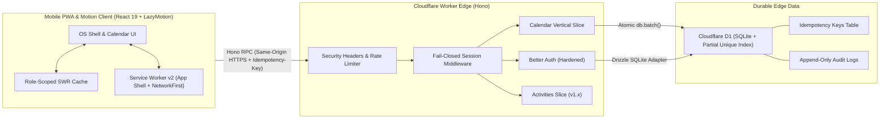
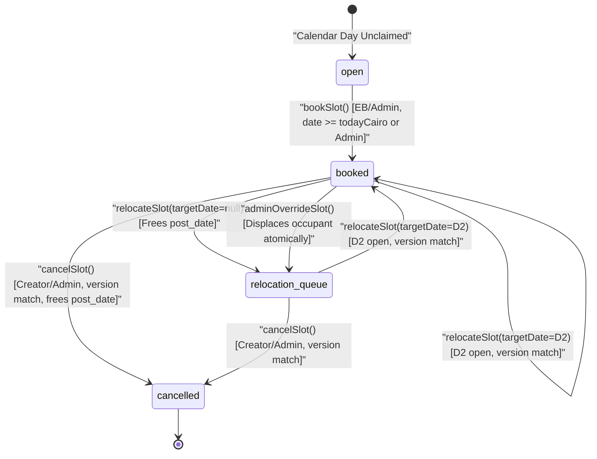
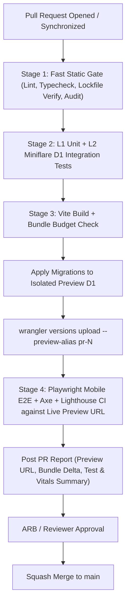

# NVMSA OS — Master Technical Architecture, Fluid Experience, Quality Engineering & Release Specification

| Control Field | Value |
| :--- | :--- |
| **Spec ID** | `NVMSA-RFC-2026-001` |
| **Title** | NVMSA OS v2.0 — "Fluidity & Ironclad Core" |
| **Status** | `Proposed for ARB Sign-Off` |
| **Author** | Principal Software Engineer, Platform Architecture & Experience |
| **Review Board** | Chief Executive Officer (Product & Delight) · Chief Technology Officer (Architecture & Security) · Principal QA Engineer (20-Yr Verification & Release Gate) |
| **Baseline Commit** | `f185f62` (`main`) |
| **Spec Branch** | `docs/nvmsa-os-master-spec` |
| **Target Runtime** | Cloudflare Workers + Cloudflare D1 (SQLite) + React 19 SPA/PWA |
| **Last Updated** | `2026-11-25` |

---

## Architecture Review Board (ARB) Sign-Off Gates

| Stakeholder | Mandate in "The Serious Room" | Blocking Exit Criteria for Release |
| :--- | :--- | :--- |
| **CEO (Product & Delight)** | Prove the app feels authentic, calm, fluid, tactile, and joyful on real mobile devices rather than a rigid form wrapper. | All 16 choreography patterns in Section 4 shipped; 60/120fps compositor-only motion; cold LCP ≤ 1.2s on 4G; zero instant layout snaps. |
| **CTO (Architecture & Security)** | Prove architectural rigor: zero P0 auth/cache leaks, atomic D1 audit integrity, deterministic timezone math, clean module isolation, and solid branch preview pipelines. | Zero P0/P1 defects; `input: false` on auth fields; role-scoped SWR purge; `db.batch()` atomicity; ephemeral Cloudflare Worker PR preview builds live. |
| **Principal QA Engineer (20-Yr Gate)** | Prove nothing breaks under network drop, concurrency races, Cairo midnight/DST, gesture interruption, accessibility, or supply-chain checks. | All 25 adversarial QA scenarios automated and green in CI (Miniflare D1 pool + Playwright mobile + axe-core + reduced-motion audit). |

---

## Table of Contents

1. [Executive Summary & v1.0 "Serious Room" Codebase Audit](#1-executive-summary--v10-serious-room-codebase-audit)
2. [Product Vision, Experience Philosophy & Quantitative SLOs](#2-product-vision-experience-philosophy--quantitative-slos)
3. [Technical Architecture & Systems Design](#3-technical-architecture--systems-design)
4. [World-Class UX, Fluid Motion & Delight Architecture](#4-world-class-ux-fluid-motion--delight-architecture)
5. [Principal QA Engineer's Verification, Edge-Case & Chaos Specification](#5-principal-qa-engineers-verification-edge-case--chaos-specification)
6. [Best-Practice Solid Branch Builds, CI/CD & Release Engineering](#6-best-practice-solid-branch-builds-cicd--release-engineering)
7. [Dependency-Ordered Implementation Roadmap (7 Branches / 7 PRs)](#7-dependency-ordered-implementation-roadmap-7-branches--7-prs)
8. [Architecture Decision Records (ADRs)](#8-architecture-decision-records-adrs)

---

## 1. Executive Summary & v1.0 "Serious Room" Codebase Audit

NVMSA OS v1.0 (`f185f62`) establishes a clean vertical-slice modular monolith across `src/shared/`, `src/server/`, and `src/client/`, backed by Cloudflare D1's partial unique index (`calendar_slots_booked_date_uidx WHERE status = 'booked'`). However, a line-by-line engineering, security, UX, and QA audit of the current repository exposes **22 verified engineering, data-integrity, build-pipeline, and user-experience gaps** that prevent v1.0 from meeting Apple-caliber production and craft standards.

This specification documents every verified gap directly against exact file paths, provides concrete architectural designs and physics constants to resolve each one permanently, and establishes an automated branch-build pipeline so no regression can ever merge to `main`.

### 1.1 Severity-Graded Defect & Gap Ledger (Verified Against Commit `f185f62`)

| ID | Severity | Area | Verified Evidence in Current Codebase | Concrete Impact | Target Fix Section |
| :--- | :--- | :--- | :--- | :--- | :--- |
| `P0-SEC-01` | **P0** | Auth / Privilege Escalation | `src/server/core/auth/auth.ts:43-55` configures Better Auth `user.additionalFields.role` and `entityCode` without `input: false`. | Better Auth's `/api/auth/sign-up/email` accepts client-supplied additional fields unless explicitly locked; any external signup request can self-assign `role: "admin"`. | [Section 3.6](#36-security-auth--stride-threat-model) |
| `P0-SEC-02` | **P0** | Client Cache / Data Leak | `src/client/core/auth/useSession.tsx:86-97` never clears `nvmsa_os_swr:*` on `signOut()`; `src/client/modules/calendar/hooks/useCalendarMonth.ts:26` passes unscoped `initialData` without `initialDataUpdatedAt`. | On a shared committee phone/tablet, an Officer signing in or browsing after an EB/Admin signs out receives cached `ManagedSlotView` (`notes`, `relocationQueue`) from `localStorage` for up to 12 hours (`cache.ts:8`). | [Section 3.5](#35-typed-api-contracts-role-scoped-caching--offline-pwa-v2) |
| `P0-DATA-01` | **P0** | DB Atomicity / Audit Trail | `src/server/modules/calendar/calendar.service.ts:133-160, 184-212, 238-262, 280-306, 326-346` runs slot mutation and `repo.appendAuditLog()` as two sequential HTTP D1 queries without `db.batch()`. | Worker timeout or transient D1 failure between statements commits the slot mutation while dropping the audit row permanently. | [Section 3.4](#34-data-layer-d1-batch-atomicity--cairo-timezone-authority) |
| `P0-DATA-02` | **P0** | Concurrency & Idempotency | `calendar.service.ts:326-329` omits `expectedVersion` in `cancelSlot()`; `POST /slots` and `POST /slots/:id/relocate` lack `Idempotency-Key` support. | An EB member clicking "Cancel" can delete a slot whose notes/title were just edited by Admin; flaky Cairo mobile 4G retries trigger spurious `409 Conflict` after succeeding server-side. | [Section 3.4](#34-data-layer-d1-batch-atomicity--cairo-timezone-authority) |
| `P1-FUNC-01` | **P1** | Cross-Month Bug | `DayCell.tsx:18` allows selecting `!cell.inCurrentMonth` dates while `CalendarPage.tsx:29-30` binds `useOptimisticBooking(month)` to the *viewed* month; `RelocationDrawer.tsx:53` only checks `bookedDates` from the active month. | Booking an overflow day (`Dec 1` clicked inside November grid) inserts the optimistic slot into November's query cache instead of December's; Relocation Drawer shows occupied dates in other months as open. | [Section 3.5](#35-typed-api-contracts-role-scoped-caching--offline-pwa-v2) |
| `P1-FUNC-02` | **P1** | Date & Schema Validation | `useCalendarMonth.ts:20` freezes `todayCairo` via `useMemo(..., [])`; `src/shared/schemas/calendar.schema.ts:8-10` validates `YearMonthSchema` with `/^\d{4}-\d{2}$/` only. | Long-lived PWA tabs highlight yesterday after `00:00 Africa/Cairo`; `GET /api/calendar/slots?month=2026-99` passes Zod validation and fails inside `Date.UTC` math. | [Section 3.4](#34-data-layer-d1-batch-atomicity--cairo-timezone-authority) |
| `P1-FUNC-03` | **P1** | Missing Documented Features | `README.md:69` promises Admin `Override slot` and `calendar.routes.ts:38-43` exposes `GET /slots/:id/history`, yet neither has a working service/UI workflow. | Admins must manually queue another team's post before claiming a date (non-atomic 2-step race); the audit log table has zero UI visibility. | [Section 3.3](#33-domain-model-formal-state-machine--mathematical-invariants) |
| `P1-PWA-01` | **P1** | Service Worker Fragility | `public/sw.js:20-34` caches failed/non-2xx responses, lacks SPA navigation fallback for `/calendar`, and calls `self.skipWaiting()` without client handshake. | Caching a transient 500 or missing hashed asset breaks offline reload; reloading `/calendar` offline throws browser network error; mid-session SW takeover breaks lazy-loaded Vite chunks. | [Section 3.5](#35-typed-api-contracts-role-scoped-caching--offline-pwa-v2) |
| `P1-SEC-03` | **P1** | Auth Config & Edge Hardening | `auth.ts:30` falls back to `http://localhost:5173`; `session.ts:61-63` swallows errors silently; `src/server/index.ts` sets no CSP/HSTS/rate limits. | Misconfigured production deployment silently signs invalid OAuth/cookie origin URLs; D1 auth outages become invisible silent logouts; login endpoint lacks brute-force throttling. | [Section 3.6](#36-security-auth--stride-threat-model) |
| `P1-BUILD-01` | **P1** | Supply-Chain & CI/CD Gaps | `package.json` lacks `"packageManager"`; `pnpm-lock.yaml` fails `ERR_PNPM_MINIMUM_RELEASE_AGE_VIOLATION` on 6 newly published deps; `.github/workflows/ci.yml` has no PR preview deploys, Miniflare D1 tests, or Playwright E2E; `deploy.yml` applies remote migrations without backup or canary traffic shift. | Local `pnpm test`/`pnpm lint` commands fail under supply-chain quarantine policies; regressions in D1 SQL, gestures, or bundle size cannot be caught before merge. | [Section 6](#6-best-practice-solid-branch-builds-cicd--release-engineering) |
| `P1-UX-01` | **P1** | Dead Sheet Chrome | `src/client/ui/BottomSheet.tsx:22-56` returns `null` when closed (zero enter/exit transition), renders a decorative non-interactive drag pill (`line 37`), lacks focus trap, lacks `body` scroll lock, and ignores `visualViewport` keyboard occlusion. | Opening/closing any sheet snaps harshly across the screen; swiping the handle does nothing; iOS soft keyboard hides form submit buttons; background page scrolls under modal. | [Section 4.3](#43-complete-16-item-fluid-interaction--animation-choreography-catalog) |
| `P1-UX-02` | **P1** | Zero Physics Engine | `src/client/index.css` is 18 lines containing only base `overscroll-behavior-y` and safe-area padding; zero spring tokens, keyframe primitives, or GPU layer promotion rules exist. | Every state change (`Grid` ↔ `Agenda`, month swap, entity filter, toast stack, bottom nav, inline cancel confirm) snaps instantaneously with zero spatial continuity or tactile delight. | [Section 4.1](#41-nvmsa-spring-physics-token-system) |
| `P1-UX-03` | **P1** | Navigation & Gestures | `CalendarGrid.tsx` only switches months via small corner arrows (`ChevronLeft`/`ChevronRight`); no horizontal swipe pager, no adjacent-month prefetch, no pull-to-refresh in standalone PWA mode. | One-handed thumb navigation on mobile feels clunky and sluggish; every month tap waits on a cold network fetch. | [Section 4.3](#43-complete-16-item-fluid-interaction--animation-choreography-catalog) |
| `P1-UX-04` | **P1** | Accessibility & Contrast | No `prefers-reduced-motion` support; `DayCell` lacks roving tabindex (`ArrowLeft`/`Right`/`Up`/`Down`) and semantic `aria-label`; `SCOPH` (`#ea580c`), `CBDD` (`#ca8a04`), and `text-slate-300` `"Open"` label fail WCAG AA contrast checks. | Keyboard-only and screen-reader users cannot efficiently traverse a 35/42-day grid; vestibular-sensitive users lack motion reduction; light `"Open"` text (`#cbd5e1` on white, ~1.5:1) is nearly invisible in bright daylight. | [Section 4.4](#44-accessibility-wcag-22-aa-prefers-reduced-motion-degradation-matrix--arabic-rtl-readiness) |

---

## 2. Product Vision, Experience Philosophy & Quantitative SLOs

### 2.1 Product Thesis
NVMSA OS is the mobile-first operational cockpit for New Valley Medical Students' Association. Because medical students coordinate fast-moving public health campaigns between clinical rotations on cellular connections, the interface must behave like a **native iOS utility**: instantaneous offline-first opening, one-handed thumb ergonomics, unmistakable feedback when a committee locks a calendar day, and zero cognitive friction under pressure.

### 2.2 Five Experience Pillars
1. **Spatial Continuity**: Nothing teleports. Sheets rise from the tapped edge while the background shell recedes in 3D depth (`scale(0.96)`); month transitions slide along the temporal X-axis (`← Past | Future →`); toggling `Grid ↔ Agenda` morphs shared geometry.
2. **Interruptible Spring Physics**: All interactive motion runs on critically/under-damped spring dynamics rather than fixed-duration curves. A user dragging a sheet halfway and flicking back immediately preserves finger velocity with zero bounce discontinuity.
3. **Zero-Perceived Latency**: Stale-While-Revalidate (SWR) role-scoped hydration + idle adjacent-month prefetch (`month ± 1`) + instant tactile press feedback (`scale(0.94)`) ensure every tap responds within **1 frame (8.3ms / 16.6ms)**.
4. **Calm Emotional Delight**: Locking a post triggers a crisp tactile lock-in choreography (subtle checkmark morph, committee-tinted pulse, optional Web Vibration/haptic pulse); hitting a 409 slot collision triggers an unmistakable horizontal damped recoil and offers a one-tap jump to the next open Cairo date.
5. **Inclusive Craft**: Full WCAG 2.2 AA contrast, keyboard roving-tabindex navigation, focus management, explicit `prefers-reduced-motion` cross-fade degradation, and CSS logical properties (`margin-inline`, `padding-inline`, `inset-inline-start`) so future Arabic RTL support requires zero layout rewrites.

### 2.3 Service-Level Objectives (SLOs) & Experience Budgets

| Domain | Service-Level Indicator (SLI) | Hard Target (SLO) | Measurement Gate |
| :--- | :--- | :--- | :--- |
| **Availability** | Non-5xx HTTP API success ratio | **≥ 99.95%** monthly | Cloudflare Workers Analytics + synthetic probe |
| **API Latency** | `GET /api/calendar/slots` p95 at Cairo Edge POP | **≤ 120 ms** | Hono request logger + Workers trace |
| **Write Latency** | `POST /api/calendar/slots` p95 (atomic D1 batch) | **≤ 200 ms** | Hono request logger + Miniflare benchmark |
| **Frame Budget** | Compositor frame time during drag/morph | **≤ 8.33 ms** (120Hz) / **≤ 16.67 ms** (60Hz) | Playwright CDP tracing (zero long frames > 50ms) |
| **Responsiveness** | Interaction to Next Paint (INP) p75 mobile | **≤ 80 ms** | Playwright Web Vitals assertion |
| **Visual Stability** | Cumulative Layout Shift (CLS) | **0.00** (max **0.02**) | Lighthouse CI mobile preset |
| **Cold Load** | Largest Contentful Paint (LCP) on Fast 4G | **≤ 1.2 s** | Lighthouse CI (simulated mobile Moto G Power) |
| **JS Budget (Entry)** | Main entry `index.js` gzipped payload (v1.0 baseline: `100.47 KB`) | **≤ 108 KB** gzipped | Vite bundle analyzer CI gate |
| **JS Budget (Async)** | Async `calendar` + lazy `domMax` motion chunks (v1.0 calendar: `10.71 KB`) | **≤ 32 KB** gzipped | Vite bundle analyzer CI gate |

---

## 3. Technical Architecture & Systems Design

### 3.1 System Context & Edge Topology

NVMSA OS executes at the Cloudflare edge as a unified **Single-Repo Modular Monolith**, eliminating cross-origin preflight overhead and keeping client/server contracts sound via `hc<AppType>` RPC type inference.



### 3.2 Modular Monolith Governance

The repository enforces structural isolation mechanically at lint and compile time rather than relying on developer discipline:

1. **Strict Zone Isolation (`eslint.config.js` + Project References)**:
   - `src/shared/**` is pure TypeScript (`tsconfig` zero DOM/Worker globals; ESLint blocks `react`, `hono`, `drizzle-orm`, `@client/*`, `@server/*`).
   - `src/client/**` permits only `import type { AppType } from '@server/index'` (`allowTypeImports: true`) and restricts cross-module imports strictly to `src/client/modules/<mod>/index.ts`.
   - `src/server/core/**` cannot import from `src/server/modules/**` except the centralized schema barrel `src/server/core/db/schema.ts`.
2. **Module Registry v2 (`src/client/app/modules.registry.ts`)**:
   - Every module declares `{ id, name, shortLabel, route, icon, status, badgeCount?, preloadChunk, component }`.
   - `AppRouter` wraps every lazy module in a dedicated **Module ErrorBoundary** with one-tap recovery (`Reset Module` / `Clear Stale Cache`) so a runtime fault in future `Activities` never crashes `Content Calendar`.
   - Hovering, focusing, or starting a touch on a `BottomNav` tab triggers `mod.preloadChunk?.()` so chunk download completes before `pointerup`.

### 3.3 Domain Model, Formal State Machine & Mathematical Invariants



#### Mathematical Domain Invariants (Enforced at Service + DB Layers)

| ID | Invariant | Enforcement Mechanism |
| :--- | :--- | :--- |
| **I1 (1-Post/Day)** | At most one row with `status = 'booked'` exists for any `post_date`. | SQLite partial unique index `calendar_slots_booked_date_uidx ON calendar_slots(post_date) WHERE status = 'booked'`. |
| **I2 (Timezone Authority)** | "Today" and "Past Date" are always evaluated in `Africa/Cairo` (UTC+2 / EEST UTC+3). | Server `getTodayCairoDate(clock())` + Client `useCairoClock()` watching midnight boundary; browser local timezone is never consulted for date locks. |
| **I3 (Strict Monotonic Version)** | Every state mutation increments `version` by exactly `+1` iff `version === expectedVersion`. | `WHERE id = ? AND version = ?` on *all* updates including `cancelSlot()`. Missing/mismatched version fails with `409 CONFLICT` (`STALE_VERSION`). |
| **I4 (Atomic Audit Parity)** | Every state mutation produces an append-only `calendar_slot_audit_logs` record in the exact same transaction. | Cloudflare D1 `db.batch([updateStmt, insertAuditStmt, insertIdempStmt])` — all succeed or all roll back. |
| **I5 (Field-Level Confidentiality)** | Unauthenticated callers and `officer` users never receive `creatorId`, `notes`, `relocationReason`, `version`, or `relocationQueue`. | DTO projection `toPublicSlotView()` vs `toManagedSlotView()` in `CalendarService` + role-partitioned client SWR keys. |
| **I6 (Valid Calendar Dates)** | Both `YYYY-MM-DD` and `YYYY-MM` reject impossible calendar months/days (`2026-00`, `2026-13`, `2026-02-29`). | Strict Zod `.refine()` checks backed by `isValidYearMonth()` and `isValidIsoDate()`. |
| **I7 (Idempotent Writes)** | Retrying a mutation with the same `Idempotency-Key` + same payload hash within 24h returns the original response without duplicating rows or triggering false 409s. | `idempotency_keys` table committed atomically inside the write batch. |

### 3.4 Data Layer, D1 Batch Atomicity & Cairo Timezone Authority

#### Migration `drizzle/0002_idempotency_and_hardening.sql`

```sql
-- 1. Idempotency store for reliable mobile write retries
CREATE TABLE IF NOT EXISTS idempotency_keys (
  key TEXT NOT NULL,
  actor_id TEXT NOT NULL,
  route TEXT NOT NULL,
  request_hash TEXT NOT NULL,
  response_status INTEGER NOT NULL,
  response_body TEXT NOT NULL,
  created_at TEXT NOT NULL,
  expires_at TEXT NOT NULL,
  PRIMARY KEY (key, actor_id, route)
);

CREATE INDEX IF NOT EXISTS idempotency_keys_expires_idx
  ON idempotency_keys (expires_at);

-- 2. Structured diff metadata on audit logs (backward-compatible nullable column)
ALTER TABLE calendar_slot_audit_logs ADD COLUMN changed_fields TEXT;

-- 3. Support fast cross-month availability & creator queries
CREATE INDEX IF NOT EXISTS calendar_slots_creator_status_idx
  ON calendar_slots (creator_id, status, post_date);
```

#### Atomic `db.batch()` Repository Contract & `adminOverrideSlot()`
`ISlotRepository` evolves from separate `insert`/`update` + `appendAuditLog` calls into atomic composite methods backed by `this.db.batch([...])` in `D1SlotRepository` (and synchronous deep-cloned array snapshots with rollback in `InMemorySlotRepository`):
- `insertWithAudit(slot, audit, idempotencyRecord?)`
- `updateWithAudit(id, patch, expectedVersion, audit, idempotencyRecord?)`
- `overrideBookedDateWithAudit({ displacedSlotId, displacedPatch, displacedAudit, incomingCommand, incomingSlot, incomingAudit, idempotencyRecord? })`

**Admin Override Semantics (`POST /api/calendar/slots/override`)**:
1. Requires `role === 'admin'`.
2. Accepts `{ targetDate, reason (min 5 chars), mode: 'create' | 'relocate', slotId?, expectedVersion?, createInput? }`.
3. Within a **single atomic `db.batch()`**:
   - Step A: Finds currently booked slot on `targetDate` (if any) and transitions its `status` → `'relocation_queue'`, `relocationReason` → `"Displaced by Admin: ${reason}"`, `version = version + 1`.
   - Step B: Inserts an `'admin_displaced'` audit log row for the displaced slot.
   - Step C: Either inserts the new `'booked'` slot or updates the existing `slotId` onto `targetDate` with `status = 'booked'`, plus its `'admin_override_booked'` audit row.
4. Both the booking committee and the displaced committee's slot remain cleanly tracked with zero lost posts and full audit accountability.

#### `YearMonthSchema` & `useCairoClock()` Midnight Authority
- Replace `/^\d{4}-\d{2}$/` in `src/shared/schemas/calendar.schema.ts` with a strict check verifying `month >= 1 && month <= 12` and `year >= 2020 && year <= 2100`.
- Introduce `useCairoClock()` on the client: computes exact milliseconds until the next `00:00:00 Africa/Cairo` boundary (handling both UTC+2 winter and UTC+3 Egypt DST transitions seamlessly via `Intl.DateTimeFormat`), schedules a timeout to flip `todayCairo`, and re-checks on `document.visibilitychange` (`visible`) and `window.focus` so backgrounded PWAs on iOS immediately re-sync after midnight or across flights.

### 3.5 Typed API Contracts, Role-Scoped Caching & Offline PWA v2

#### API Endpoint Matrix (Hono RPC `hc<AppType>`)

| Method & Path | Min Role | Headers | Request / Query | Success & Conflict Semantics |
| :--- | :--- | :--- | :--- | :--- |
| `GET /api/calendar/slots` | Public | `If-None-Match` (opt) | `?month=YYYY-MM` | `200` (`PublicSlotView[]` for officer/anon; `ManagedSlotView[]` + `relocationQueue` for EB/Admin). Supports `ETag` + `304`. |
| `GET /api/calendar/availability` | `eb` | — | `?from=YYYY-MM-DD&to=YYYY-MM-DD` | `200` `{ bookedDates: string[] }` lightweight bitmap/list (max 90 days) so `RelocationDrawer` validates cross-month targets live. |
| `GET /api/calendar/slots/:id/history` | `eb` | — | Path `id` | `200` `{ history: SlotAuditLogEntry[] }` ordered newest-first. Wired into Slot Details Timeline Drawer. |
| `POST /api/calendar/slots` | `eb` | `Idempotency-Key` | `CreateSlotInput` | `201` `{ slot }` or `409` `{ code: 'DATE_ALREADY_BOOKED', occupyingEntity, nextAvailableDate }`. |
| `PATCH /api/calendar/slots/:id` | `eb` (own) / `admin` | `Idempotency-Key` | `UpdateSlotInput` (requires `expectedVersion`) | `200` `{ slot }` or `409` `{ code: 'STALE_VERSION', currentVersion }`. |
| `POST /api/calendar/slots/:id/relocate` | `eb` (own) / `admin` | `Idempotency-Key` | `RelocateSlotInput` (requires `expectedVersion`) | `200` `{ slot }` or `409` (`DATE_ALREADY_BOOKED` or `STALE_VERSION`). |
| `POST /api/calendar/slots/override` | `admin` | `Idempotency-Key` | `AdminOverrideInput` | `200`/`201` `{ slot, displacedSlot }` via atomic `db.batch()`. |
| `DELETE /api/calendar/slots/:id` | `eb` (own) / `admin` | `Idempotency-Key` | `?expectedVersion=N` (or JSON body) | `200` `{ slot }` (`status: 'cancelled'`). Fails `409` if stale version. |

#### Role-Scoped SWR Cache & Auth Transition Purge (`src/client/core/storage/cache.ts`)
To eliminate `P0-SEC-02` permanently:
1. Partition every cache key by auth scope: `nvmsa_os_swr:v2:<scope>:calendar:<YYYY-MM>`, where `<scope>` is `public` when unauthenticated or `<role>:<userId>` when signed in.
2. Return `{ data, updatedAt }` from `readSwrCache()` and wire `initialDataUpdatedAt: cached?.updatedAt` into `useQuery`, preventing TanStack Query from treating 11-hour-old `localStorage` data as freshly fetched (respecting `staleTime: 30_000`).
3. Call `clearAllSwrCache()` synchronously inside `signIn()`, `signOut()`, and `switchDevPersona()` alongside `queryClient.clear()`.

#### Service Worker v2 (`public/sw.js`)
1. **Strict Cache Eligibility**: Only cache `GET` same-origin responses where `res.ok === true && res.type === 'basic'` and URL is NOT `/api/*`.
2. **SPA Navigation Fallback**: For `request.mode === 'navigate'`, use NetworkFirst with 3s timeout falling back to cached `/index.html`, ensuring deep links (`/calendar`, `/activities`) render offline instead of showing a browser crash page.
3. **Safe Update Lifecycle**: Remove blind `self.skipWaiting()` during active sessions. When a new SW reaches `installed` while a controller exists, show a calm floating banner (`"Update ready — Refresh"`); tapping Refresh posts `{ type: 'SKIP_WAITING' }` and cleanly reloads once `controllerchange` fires, preventing mid-session Vite hashed-chunk 404 errors.

### 3.6 Security, Auth & STRIDE Threat Model

| STRIDE Threat | v1.0 Exposure | v2.0 Mitigation (Concrete Implementation) |
| :--- | :--- | :--- |
| **Spoofing** | `BETTER_AUTH_URL` falls back to `http://localhost:5173`; dev impersonation headers exist in source. | Throw startup error if `APP_ENV !== 'development'` and `BETTER_AUTH_URL` is missing or not `https://`; retain double-gate `APP_ENV === 'development' && ALLOW_DEV_IMPERSONATION === 'true'`; enforce strict `trustedOrigins`. |
| **Tampering** | Self-signup could pass `role: "admin"` (`P0-SEC-01`). | Set `input: false` on `user.additionalFields.role` and `entityCode` in `src/server/core/auth/auth.ts`; disable public open registration unless gated by admin invite or verified domain policy; enforce `expectedVersion` on `cancelSlot()`. |
| **Repudiation** | Slot mutation and audit row are non-atomic (`P0-DATA-01`); audit logs lack field-level diffs. | Commit slot change + structured `changed_fields` audit record inside a single `db.batch()`. |
| **Information Disclosure** | `signOut()` leaves privileged `ManagedSlotView` data in `localStorage` (`P0-SEC-02`); `session.ts` swallows exceptions silently; missing CSP headers. | Partition SWR cache by `role:userId` + wipe on `signOut()`; emit structured `auth_session_error` logs in `session.ts`; attach strict `Content-Security-Policy`, `X-Content-Type-Options: nosniff`, `X-Frame-Options: DENY`, `Referrer-Policy: strict-origin-when-cross-origin`, and `Permissions-Policy`. |
| **Denial of Service** | Unthrottled `/api/auth/*` and write endpoints; unbounded `month` range queries. | Configure Cloudflare Workers Rate Limiting binding (`AUTH_LIMITER`: 10 req/min/IP on `/api/auth/*`; `WRITE_LIMITER`: 30 req/min/user on calendar writes); enforce strict `YearMonthSchema` bounds (`2020-01`..`2100-12`). |
| **Elevation of Privilege** | Client `RoleGate` could be mistaken for security if API misses `requireRole`. | Every write/history route enforces `requireRole('eb')` + resource policy (`defaultCalendarPolicy`); Admin override routes check `requireRole('admin')`. |

---

## 4. World-Class UX, Fluid Motion & Delight Architecture

This section addresses the Board's core critique directly: functional correctness is table stakes. What separates an Apple-grade app from a generic CRUD dashboard is **physical honesty, spatial continuity, tactile responsiveness, and calm emotional delight** at 60–120fps.

### 4.1 NVMSA Spring Physics Token System

All motion in NVMSA OS is governed by five named spring tokens exposed via `src/client/core/motion/tokens.ts` and powered by `motion/react` (`LazyMotion` + async `domMax` feature bundle loaded dynamically so the main entry bundle remains `≤ 108 KB` gzipped):

| Token Name | Stiffness | Damping | Mass | Approx. Settle | Target Interactions |
| :--- | :---: | :---: | :---: | :---: | :--- |
| `spring.snappy` | `520` | `36` | `0.8` | ~180 ms | Button press release, `DayCell` tap rebound, segmented control pill, BottomNav indicator |
| `spring.fluid` | `380` | `34` | `1.0` | ~260 ms | `BottomSheet v2` open/snap, `MobileShell` background depth scale (`0.96`), inline disclosure expand |
| `spring.gentle` | `260` | `30` | `1.0` | ~340 ms | Month pager horizontal slide settle, filter chip bar scroll-to-center, skeleton cross-fade |
| `spring.bouncy` | `460` | `22` | `0.9` | ~320 ms | Slot lock-in celebration pop, odometer badge count increment, checkmark SVG draw |
| `spring.recoil` | `680` | `24` | `0.7` | ~280 ms | 409 slot-conflict horizontal shake (`keyframes [0, -10, 9, -6, 4, 0]`), invalid submit shake |

### 4.2 GPU Compositor & 120Hz ProMotion Frame-Budget Contract

1. **Compositor-Only Property Rule**: Continuous animations and gesture frames may ONLY animate `transform` (`translate3d`, `scale`, `rotate`), `opacity`, and `clip-path`. Animating `height`, `width`, `top`, `left`, `margin`, or `box-shadow` directly during 60/120Hz frames is **prohibited** in code review (with FLIP `layout` transforms used cleanly for Grid ↔ Agenda and inline disclosures).
2. **Zero Layout Thrashing**: Gesture handlers (`onPointerMove` / `useDrag`) read `visualViewport` or container dimensions once on `pointerdown` and mutate `MotionValue` instances directly outside React's render tree — **zero `setState()` calls per animation frame**.
3. **120Hz Budget**: Each frame in a drag gesture must complete JavaScript work in `< 2.5 ms` so total frame commit stays safely below `8.33 ms` on 120Hz iPhone Pro / Android OLED panels.

### 4.3 Complete 16-Item Fluid Interaction & Animation Choreography Catalog

#### 1. Physics `BottomSheet v2` (`src/client/ui/BottomSheet.tsx`)
- **Trigger**: Opening `BookingSheet`, `RelocationDrawer`, `SignInSheet`, or `AuditTimelineDrawer`.
- **Gesture & Physics**:
  - Mounts inside `AnimatePresence`; enters from `translateY(100%)` on mobile (`< 640px`) using `spring.fluid` (on `sm:+` desktop, scales gracefully from `0.96` + `opacity: 0`).
  - Header drag bar + sheet header respond to vertical Pointer Events (`drag="y"` with `dragElastic={{ top: 0.08, bottom: 0.4 }}`): dragging upward hits logarithmic rubber-band resistance; dragging downward > `30%` height OR flicking with velocity > `450 px/s` immediately dismisses with inherited velocity (`initialVelocity`).
  - **Scroll-vs-Drag Arbitrator**: Drag-to-dismiss activates when internal scroll body is at `scrollTop <= 0` and drag delta `dy > 0`, preventing accidental dismissal while scrolling long relocation lists.
  - **Viewport Depth Stacking**: Parent `MobileShell` subscribes to a shared `sheetProgress` `MotionValue` (`0 → 1`), interpolating `scale(1 → 0.96)`, `borderRadius(0px → 16px)`, and subtle brightness dim (`1 → 0.92`) in lockstep with the user's thumb!
  - **Keyboard & Focus Hygiene**: Subscribes to `window.visualViewport` resize/scroll events to adjust `paddingBottom` smoothly above iOS/Android virtual keyboards; traps Tab focus inside the dialog; locks background body scroll cleanly (`overscroll-behavior: contain` + scroll-position preservation); restores focus to the exact originating `DayCell` on close.

#### 2. Swipeable Month Pager (`CalendarGrid v2`)
- **Trigger**: Horizontal swipe left/right anywhere on the 7-column grid, or tapping Prev / Next / Today.
- **Physics & Choreography**:
  - Horizontal `drag="x"` tracks the user's finger 1:1 while previewing the adjacent month edge. Release past `25%` width or velocity > `350 px/s` commits the month shift along the temporal direction vector (`dir = +1` slides left, `dir = -1` slides right) using `spring.gentle`.
  - **Idle Adjacent Prefetch**: As soon as month `M` settles, `useCalendarMonth` triggers low-priority `queryClient.prefetchQuery` for `M - 1` and `M + 1`, making the actual swipe visually instantaneous (`0ms` spinner).
  - **Month Heading Odometer**: Month title (`November 2026` → `December 2026`) vertically cross-slides (`±14px` + `opacity`) in the direction of time.

#### 3. Spatial Continuity (`DayCell v2`)
- **Trigger**: Pointer down, hover, selection, and sheet dismissal.
- **Choreography**:
  - `pointerdown`: Immediate tactile scale down `scale(0.94)` in 1 frame (`transition: transform 80ms ease-out`); released to `1.0` via `spring.snappy`.
  - **Selected Anchor Ring**: When `BookingSheet` opens for `2026-12-05`, that cell displays a crisp animated teal highlight ring (`layoutId="selected-day-ring"`) that stays anchored while the sheet is open and gracefully fades as focus returns on dismiss.
  - **Overflow Adjacent Cells**: Cells with `!cell.inCurrentMonth` clearly indicate subtle muted depth; tapping one cleanly routes `BookingSheet` and `useOptimisticBooking` to *that cell's* `YYYY-MM` month (`input.postDate.slice(0, 7)`) and smoothly pans the grid to that month if booked!

#### 4. Grid ↔ Agenda Shared-Layout Morph & Spring Segmented Control
- **Trigger**: Tapping `Grid` or `Agenda` segmented toggle.
- **Choreography**:
  - The segmented control pill uses Framer Motion `layoutId="calendar-view-pill"` (`spring.snappy`) so the white active thumb physically glides across the track rather than flashing on/off.
  - Switching views triggers directional `AnimatePresence mode="popLayout"` cross-translation (`Grid` fades/scales down softly from `1 → 0.97` while `Agenda` rows stagger in at `20ms` intervals capped at 8 visible rows).

#### 5. Fluid Entity Filter Ribbon (`All` + 11 NVMSA Entities)
- **Trigger**: Tapping any committee/division filter chip (`SCOPH`, `SCORA`, `SCORP`, `SCOME`, `SCOPE`, `SCORE`, `PNSDD`, `PSDD`, `CBDD`, `FSDD`, `EB`).
- **Choreography**:
  - Active background pill slides horizontally across chips via `layoutId="entity-filter-pill"` (`spring.snappy`) tinted in the selected committee's brand color!
  - Horizontal scroll ribbon features CSS gradient edge fade masks (`mask-image`) and auto-scrolls the tapped chip smoothly toward center (`scrollIntoView({ inline: 'center', behavior: 'smooth' })`).
  - **Spatial Context Preservation**: On the calendar grid, non-matching booked slots smoothly dim to `opacity: 0.28, saturate(0.4)` (`200ms`) rather than abruptly vanishing, keeping busy days visually honest while highlighting the filtered committee's footprint.

#### 6. Slot Lock-In Celebration Choreography
- **Trigger**: Successful `bookSlot()` confirmation (`201 Created`).
- **Choreography**:
  1. Immediately on submit (`onMutate`), the target `DayCell` renders an optimistic frosted card with a subtle pulsing border.
  2. When the server confirms `201`: the cell runs a `spring.bouncy` pop (`1.0 → 1.08 → 1.0`), an SVG padlock/checkmark badge draws itself over `240ms`, and **6 lightweight radial SVG particles** tinted in the committee's hex color (`NVMSA_ENTITY_MAP[entityCode].color`) burst outward `18px` and fade (`380ms`, GPU-only).
  3. On supported Android/mobile browsers, triggers a subtle `navigator.vibrate?.(12)` haptic tick (guarded cleanly behind user gesture and reduced-motion check).

#### 7. Conflict & Error Physics (`409` / Validation Guard)
- **Trigger**: Attempting to book/relocate onto a date taken concurrently (`409 DATE_ALREADY_BOOKED`) or editing a stale version (`409 STALE_VERSION`).
- **Choreography**:
  - Active sheet card triggers `spring.recoil` horizontal damped oscillation (`x: [0, -10, 9, -6, 3, 0]`) + `navigator.vibrate?.([15, 40, 15])`.
  - Inline banner smoothly expands (`AnimatePresence`) showing *which committee* holds the date plus a **one-tap `"Jump to next open date (Dec 14)"`** smart recovery chip calculated immediately from cached/availability data!
  - On `STALE_VERSION`, displays a diff comparison hint and `"Reload Latest Version"` button without wiping the user's typed title/notes draft.

#### 8. Relocation Queue Flight & Odometer Counter Badge
- **Trigger**: Moving a slot to the Relocation Queue, or assigning a queued slot back onto an open calendar date.
- **Choreography**:
  - `Queue (N)` button in `CalendarPage` displays an **odometer counter** (`AnimatePresence` vertical digit slide `y: ±12px` with `tabular-nums`) whenever `relocationQueue.length` increments or decrements, accompanied by an amber attention pulse when a slot enters the queue.
  - Assigning a queued post onto a date closes the drawer, pans the calendar smoothly to the target month if different, and pulses the newly claimed `DayCell`.

#### 9. Smooth Inline Disclosures (`BookingSheet`)
- **Trigger**: Clicking `"Move to Queue"` or `"Cancel Slot"` inside `BookingSheet`.
- **Choreography**:
  - Action buttons morph smoothly via `AnimatePresence mode="wait"` + `motion.div layout` into the confirmation/reason panel rather than abruptly jumping the modal height.

#### 10. Dynamic-Island-Style Stacked Toast System (`src/client/app/providers.tsx`)
- **Trigger**: Any `pushToast(message, tone, options?)` invocation.
- **Choreography**:
  - Top/bottom-floating pill enters with `spring.bouncy` (`y: 20 → 0, scale: 0.92 → 1, opacity: 0 → 1`).
  - Maximum 3 visible toasts stack with progressive vertical compression (`scale(1 - idx * 0.04)`, `translateY(-idx * 6px)`).
  - Swipe horizontally/downward to dismiss manually; optional `Undo` action button (e.g., 4-second grace window or instant re-open) and a hairline GPU `scaleX(1 → 0)` countdown bar that pauses on pointer hover/hold.
  - All timers stored in `useRef` and cleaned up on unmount/dismiss.

#### 11. Bottom Navigation Spring Pill & Cross-Module Route Transitions
- **Trigger**: Switching tabs (`Calendar` / `Activities` / `Members`).
- **Choreography**:
  - Active tab icon elevates with a subtle `spring.snappy` scale (`1.08`) above a shared `layoutId="bottom-nav-pill"` capsule background.
  - Route `<Outlet />` transitions gently cross-fade/slide (`opacity: 0 → 1, y: 6 → 0` over `180ms`) without janking the persistent `SafeAreaHeader` or `BottomNav`.

#### 12. Today Sonar Beacon & Smooth "Jump to Today" Homing
- **Trigger**: Viewing the current month or tapping `"Today"` from any past/future month.
- **Choreography**:
  - Today's date circle renders a calm concentric sonar ring (`scale(1 → 1.6)`, `opacity(0.35 → 0)` every `4s`, pausing when tab is hidden).
  - Tapping `"Today"` pans horizontally back to `getCurrentCairoMonth()` and flashes a brief double-pulse homing ring around today's cell.

#### 13. Anatomically Matched Shimmer Skeletons & Optimistic Ghost States
- **Trigger**: Initial cold network load when no SWR cache exists for a month.
- **Choreography**:
  - Renders a 35-cell `CalendarGridSkeleton` matching exact `min-h-[74px] sm:min-h-[88px]` cell geometry (`CLS = 0.00`), swept by a single synchronized GPU `translateX(-100% → 100%)` gradient sheen.
  - Cross-fades smoothly to hydrated cells (`160ms`).

#### 14. Standalone PWA Elastic Pull-to-Refresh
- **Trigger**: Pulling down at `scrollY === 0` in standalone iOS/Android PWA mode (`display-mode: standalone`).
- **Choreography**:
  - Rubber-band overscroll stretches an Apple-style circular spinner arc (`0% → 100%` `pathLength`) proportional to pull distance (`0–64px`), snapping at threshold to trigger `queryClient.invalidateQueries` with haptic click, without fighting normal page scroll (`overscroll-behavior-y: contain` in browser mode).

#### 15. Interactive Audit History Timeline Drawer
- **Trigger**: Tapping `"History (N edits)"` inside `BookingSheet` (visible to EB/Admin).
- **Choreography**:
  - Fetches `GET /api/calendar/slots/:id/history` and unfolds a vertical timeline rail (`booked` → `updated` → `queued_for_relocation` → `relocated` → `admin_displaced` → `cancelled`) with staggered row reveal (`25ms`), actor role badge, Cairo timestamp, and field diff badges.

#### 16. Warm, Entertaining Empty States & Milestone Micro-Copy
- **Trigger**: Empty Agenda filter result, empty Relocation Queue, or Planned module placeholder.
- **Choreography**:
  - Custom lightweight vector illustrations (inline crisp SVG, `< 1.5 KB` total) with subtle idle float (`y: ±3px`, 3.5s ease-in-out) and human, committee-aware copy (e.g., *"All clear — no posts waiting in the queue."* / *"0 SCOPH posts booked in December — tap any open day on the grid to claim your campaign spot."*), plus a quiet header progress pill showing monthly coverage (`"18 / 30 days claimed"`).

### 4.4 Accessibility (WCAG 2.2 AA), `prefers-reduced-motion` Degradation Matrix & Arabic RTL Readiness

#### Reduced-Motion Policy
Wrapped globally in `<MotionConfig reducedMotion="user">` at `AppProviders` root plus a CSS `@media (prefers-reduced-motion: reduce)` rule:

| Interaction | Full Motion Experience | Reduced-Motion (`reduce`) Fallback |
| :--- | :--- | :--- |
| `BottomSheet v2` | Spring slide-up + shell `scale(0.96)` | Instant `120ms` opacity cross-fade, zero scale/translation |
| `CalendarGrid` Month Swap | Horizontal directional slide + odometer title | Instant cross-fade (`100ms`), zero horizontal slide |
| `Grid ↔ Agenda` / Filter Chips | `layoutId` spring morphing | Static highlight border swap, zero flying pill |
| Lock-In Celebration | `spring.bouncy` pop + radial SVG burst + vibrate | Instant checkmark appear, **no particles**, **no shake**, **no vibrate** |
| 409 Conflict Feedback | Horizontal `spring.recoil` shake | Crisp high-contrast error border highlight + alert icon |
| Today Sonar Beacon | Looping radial pulse | Static high-contrast `2px` teal border ring |

#### Keyboard Navigation & Screen Reader Semantics
1. **Roving Tabindex 7-Column Grid**: Inside `CalendarGrid`, `ArrowRight`/`ArrowLeft` move focus `±1` day, `ArrowDown`/`ArrowUp` move `±7` days, `Home`/`End` jump to start/end of week, `PageUp`/`PageDown` shift months, and `Enter`/`Space` open `BookingSheet` on that cell.
2. **Semantic `aria-label` on `DayCell`**: Reads full context cleanly — e.g., `"Friday, December 5, 2026 — Booked by SCOPH: World Health Day Awareness Campaign"` or `"Saturday, December 6, 2026 — Open slot"`.
3. **ARIA Live Regions**: Polite `aria-live="polite"` status announcer declares `"Loaded December 2026, 14 posts booked"` on month change; assertive `aria-live="assertive"` announces 409 conflict alerts.

#### Color Contrast Audit (WCAG 2.2 AA `≥ 4.5:1` Text, `≥ 3:1` UI Indicators)
- **Verified v1.0 Violations**:
  - `DayCell.tsx:63` uses `text-slate-300` (`#cbd5e1` on `#ffffff` = **1.54:1** — fails). **Fix**: Upgrade open label to `text-slate-500` (`#64748b` on `#ffffff` = **4.76:1**) or subtle dashed `+` affordance icon at ≥ `3:1`.
  - `committees.ts` (`SCOPH` `bg-orange-100 text-orange-800`, `SCORA` `bg-red-100 text-red-800`) and `divisions.ts` (`CBDD` `bg-amber-100 text-amber-800` at `10px` font): enforce `>= 4.5:1` foreground/background ratio across all 11 entity tokens via automated contrast unit test (moving `CBDD` text to `text-amber-950` / `bg-amber-100` where `#451a03` on `#fef3c7` gives **> 12:1**).

#### Arabic RTL Readiness
- Replace positional spacing (`ml-1`, `-mx-2`, `text-left`) with CSS logical utilities (`ms-1`, `text-start`), and flip directional swipe polarity (`rtl ? -delta : delta`) via `document.dir` so enabling `ar-EG` in v2.x works out of the box.

---

## 5. Principal QA Engineer's Verification, Edge-Case & Chaos Specification

### 5.1 4-Layer Testing Pyramid & Quantitative Coverage Gates

| Layer | Runner & Environment | Scope & Target Coverage | Mandatory Gate |
| :--- | :--- | :--- | :--- |
| **L1: Unit & Domain** | Vitest (`node`) | Shared schemas, Cairo date/DST math, policy rules, spring/contrast invariants. **≥ 95%** coverage on `src/shared/` & `*.policy.ts`. | Blocking in CI |
| **L2: Real Edge Runtime & D1 SQL** | `@cloudflare/vitest-pool-workers` (Miniflare SQLite D1) | Real SQL migrations (`0000`..`0002`), `db.batch()` atomicity, partial unique index race tests, `Idempotency-Key`, Better Auth `input: false` signup check. **≥ 90%** coverage on `src/server/`. | Blocking in CI |
| **L3: Component & Accessibility** | Vitest + Testing Library + `vitest-axe` | `BottomSheet` focus trap & Escape, `BookingSheet` role matrix, roving tabindex keyboard nav, zero `axe-core` AA violations. | Blocking in CI |
| **L4: Mobile E2E, Gestures & Visual** | Playwright (`iPhone 14 Pro` 390×844 + `Pixel 7` + `prefers-reduced-motion`) | Swipe month navigation, drag-to-dismiss sheet, keyboard avoidance, offline PWA reload, visual snapshots, Web Vitals / frame budget check. | Blocking on PRs |

### 5.2 The 25-Scenario Adversarial QA Edge-Case Matrix

| # | Category | Scenario & Adversarial Steps | Expected System Behavior | Verification Layer |
| :--- | :--- | :--- | :--- | :--- |
| **QA-01** | Concurrency | Two EB members fire simultaneous `POST /api/calendar/slots` for `2026-12-15`. | Exactly 1 returns `201 Created`; second hits partial unique index inside `db.batch()` and returns `409 DATE_ALREADY_BOOKED` with zero orphaned audit rows. | L2 (Miniflare) |
| **QA-02** | Idempotency | Client sends `POST /slots` with `Idempotency-Key: K1`, drops offline before reading response, retries with `K1` 5s later. | Server returns cached `201` response from `idempotency_keys` without duplicate booking or false `409`. | L2 |
| **QA-03** | Idempotency Mismatch | Caller reuses `Idempotency-Key: K1` with a *different* JSON payload (`title` changed). | Server rejects with `422 IDEMPOTENCY_CONFLICT` (`400`/`422`). | L2 |
| **QA-04** | Version Race (Cancel) | Admin updates `notes` (`version 1 → 2`) while creator clicks `Cancel Slot` with stale `expectedVersion: 1`. | `DELETE /slots/:id?expectedVersion=1` rejects with `409 STALE_VERSION`; slot remains booked. | L1 + L2 |
| **QA-05** | Atomic Audit Rollback | Simulate D1 constraint failure on the second statement inside `updateWithAudit` / `overrideBookedDateWithAudit`. | `db.batch()` rolls back completely: original slot stays unchanged, zero partial audit log exists. | L2 |
| **QA-06** | Self-Signup PrivEsc | Attacker calls `POST /api/auth/sign-up/email` with `{"role":"admin","entityCode":"PNSDD"}`. | Better Auth strips/ignores `role` & `entityCode` (`input: false`); created row has `role: 'officer'`. | L2 |
| **QA-07** | Prod Impersonation | Attacker sends `x-dev-role: admin` header against production worker (`APP_ENV=production`). | `sessionMiddleware` ignores header completely; `/api/me` returns `null`, `POST /slots` returns `401`. | L2 |
| **QA-08** | Shared Device Logout | EB Member loads December (`notes` visible), clicks `Sign Out`, then Officer/Anon refreshes page. | `localStorage` SWR keys wiped synchronously on `signOut()`; Officer sees zero EB `notes` and empty `relocationQueue`. | L4 (Playwright) |
| **QA-09** | Cairo Midnight Rollover | App stays open at `2026-11-25 23:59:55 Africa/Cairo` (`21:59:55 UTC`) while user is in `UTC-5` browser timezone; wait 10s past Cairo midnight. | `useCairoClock` shifts `todayCairo` to `2026-11-26`; `2026-11-25` becomes past-locked for EB immediately. | L1 + L4 (Clock Mock) |
| **QA-10** | Egypt DST Boundary | Run `shiftYearMonth`, `buildMonthGrid`, and `getTodayCairoDate` across Egypt Spring Forward (last Friday of April) and Fall Back (last Thursday of October). | Zero skipped or duplicated calendar dates (`getMonthDateBounds` uses UTC calendar arithmetic + Cairo formatter). | L1 |
| **QA-11** | Leap Year Bounds | Navigate to `2028-02` (leap) and `2026-02` (non-leap); submit `2026-02-29` via raw API. | `2028-02` renders 29 days; `2026-02` renders 28 days; `2026-02-29` returns `400 VALIDATION_ERROR`. | L1 + L2 |
| **QA-12** | Invalid Month Query | Request `GET /api/calendar/slots?month=2026-00` and `?month=2026-13`. | `YearMonthSchema` rejects both cleanly with `400`, never hitting D1. | L1 + L2 |
| **QA-13** | Overflow Day Booking | View November 2026; tap trailing overflow cell `2026-12-01` and book a post. | Optimistic update & invalidation target `['calendar', 'month', '2026-12']`, and grid switches smoothly to December. | L3 + L4 |
| **QA-14** | Cross-Month Relocation | Queue a post from Nov 28; open `RelocationDrawer` and pick an already-booked date in *December* while viewing *November*. | Live `GET /api/calendar/availability` flags the December date as occupied inline and disables `Assign Date`. | L4 |
| **QA-15** | Atomic Admin Override | Admin overrides an occupied date held by `SCOPH` to assign an urgent `EB` announcement. | `SCOPH` post moves atomically to `relocation_queue` with displacement reason + audit trail; `EB` post becomes `booked` on that date. | L1 + L2 |
| **QA-16** | Audit Log Integrity | Book → Edit → Move to Queue → Admin Override → Re-book slot; inspect `GET /slots/:id/history`. | Returns 5 chronologically ordered audit entries with exact actor names, roles, `previousDate`/`nextDate`, and `changedFields`. | L2 + L4 |
| **QA-17** | Drag-to-Dismiss Mid-Scroll | Scroll inside `RelocationDrawer` with 25 items, then drag upward vs downward when `scrollTop > 0` vs `scrollTop === 0`. | Internal scroll consumes touch when `scrollTop > 0`; sheet drag dismisses only at `scrollTop === 0` downward pull. | L4 (Touch) |
| **QA-18** | Gesture Interruption | Begin swiping `CalendarGrid` 40% left, reverse thumb mid-flight and release right. | Sheet/pager snaps cleanly back to original month preserving gesture velocity with zero stuck states. | L4 (Touch) |
| **QA-19** | iOS Soft Keyboard Avoidance | Focus `Internal Notes` textarea at bottom of `BookingSheet` on `390×844` mobile viewport with `visualViewport` shrunk 300px. | Submit button `"Lock Post Slot"` remains visible above keyboard and tappable without overlapping footer. | L4 |
| **QA-20** | Offline Deep-Route Reload | Navigate to `/calendar`, switch Playwright context to `offline: true`, execute hard reload (`page.reload()`). | Service Worker serves cached app shell + SWR data with calm `"Offline — showing saved schedule"` indicator; zero browser error page. | L4 |
| **QA-21** | Chunk-Hash SW Update | Deploy v2 mock asset manifest while v1 client tab is open; simulate SW update arrival. | Old tab continues working uninterrupted on v1 chunks until user taps `"Refresh"` banner, then swaps cleanly. | L4 |
| **QA-22** | Keyboard & Screen Reader | Navigate entire month grid + open/close `BookingSheet` + filter chips using only `Tab`, `Arrow*`, `Enter`, `Escape`. | Roving tabindex navigates 35/42 days smoothly; Escape closes top sheet only and restores focus to originating `DayCell`; 0 `axe-core` AA errors. | L3 + L4 |
| **QA-23** | Reduced Motion Audit | Enable `emulateMedia({ reducedMotion: 'reduce' })` and execute book, 409 error, month change, and Grid/Agenda toggle. | Zero transform animations > 50ms, zero shake, zero particles, zero haptic vibrate calls; all state feedback remains clear. | L4 |
| **QA-24** | 100-Item Queue Stress | Seed 100 items in `relocationQueue` + 31 booked posts in month on throttled 4x CPU mobile emulation. | Initial render < 100ms; opening `RelocationDrawer` maintains 60fps scroll with zero dropped frames > 50ms. | L4 |
| **QA-25** | Auth Rate Limit & Headers | Burst 15 rapid `POST /api/auth/sign-in/email` requests from single IP; inspect security headers on `/`. | Requests 11–15 return `429 RATE_LIMITED`; `/` and `/api/*` include strict CSP, `X-Frame-Options: DENY`, `nosniff`. | L2 |

### 5.3 Performance, Bundle & Lighthouse CI Quality Gates

| Gate Check | Fail Threshold | Target |
| :--- | :--- | :--- |
| Main entry JS bundle (`dist/client/assets/index-*.js` gzip; v1.0: `100.47 KB`) | `> 115 KB` | `≤ 108 KB` |
| Async calendar + lazy `domMax` motion chunks (gzip; v1.0 calendar: `10.71 KB`) | `> 40 KB` | `≤ 32 KB` |
| CSS bundle (`dist/client/assets/index-*.css` gzip; v1.0: `6.51 KB`) | `> 18 KB` | `≤ 12 KB` |
| Lighthouse Performance (Mobile 4G) | `< 92` | `≥ 96` |
| Lighthouse Accessibility | `< 98` | `100` |
| Lighthouse Best Practices & PWA | `< 95` | `100` |
| Cumulative Layout Shift (CLS) | `> 0.02` | `0.00` |

---

## 6. Best-Practice Solid Branch Builds, CI/CD & Release Engineering

### 6.1 Git Branching Topology, Naming & Protection Rules

- **`main` (Protected Production Branch)**:
  - Direct pushes blocked; linear history enforced (Squash & Merge via PR only).
  - Requires **1 approving review**, **all CI status checks green** (Lint, Typecheck, Unit, Miniflare D1, Playwright Mobile, Lighthouse/Bundle budget), and **branch up-to-date with `main`**.
- **Feature & Fix Branch Naming**:
  - `feat/<module>-<short-kebab>` (e.g., `feat/calendar-physics-sheet`)
  - `fix/<module>-<short-kebab>` (e.g., `fix/auth-signup-role-lock`)
  - `ci/<scope>-<short-kebab>` (e.g., `ci/branch-preview-builds`)
  - `docs/<scope>-<short-kebab>` (e.g., `docs/nvmsa-os-master-spec`)
  - `test/<scope>-<short-kebab>` (e.g., `test/playwright-mobile-gauntlet`)
- **Commit Discipline**: Conventional Commits scoped by module (`fix(auth): ...`, `feat(motion): ...`, `perf(pwa): ...`).

### 6.2 Deterministic Supply-Chain Governance

During v1.0 verification (`2026-11-25`), running `pnpm test` under a strict `minimumReleaseAge` policy failed with `ERR_PNPM_MINIMUM_RELEASE_AGE_VIOLATION` on 6 newly published transitive/direct dependencies (`@cloudflare/vite-plugin@1.70.2`, `hono@4.13.22`, `@types/react@19.3.3`, `@types/estree@1.0.11`, `electron-to-chromium@1.5.494`, `ignore@7.0.17`).

To make branch builds **100% deterministic across every engineer laptop and CI runner**:
1. Pin `"packageManager": "pnpm@9.15.4"` in `package.json` and enable Corepack in setup docs.
2. Add explicit `minimumReleaseAge: 1440` (24 hours) + `minimumReleaseAgeExclude` (only when vetted/necessary, otherwise never bump lockfile entries within 24h of npm publish!) in `pnpm-workspace.yaml` so CI enforces the exact same supply-chain rules as local workstations.
3. Run `pnpm audit --prod --audit-level=high` on every PR and schedule weekly Dependabot batched updates whose release timestamps satisfy the 24h quarantine window.

### 6.3 Ephemeral PR Branch Preview Build Pipeline

Every non-draft Pull Request produces a **real, live Cloudflare Worker preview URL** (`https://pr-<PR_NUMBER>-nvmsa-os.<account>.workers.dev`) tested against an isolated preview D1 database before a human ever merges it.



#### Target `.github/workflows/ci.yml` Specification (Reference Pipeline)

```yaml
name: Solid Branch CI & Preview Build

on:
  pull_request:
    branches: [main]
  push:
    branches: [main]

concurrency:
  group: ci-${{ github.ref }}
  cancel-in-progress: true

jobs:
  static-and-unit:
    name: Static, Security & L1/L2 Tests
    runs-on: ubuntu-latest
    steps:
      - uses: actions/checkout@v4
      - uses: pnpm/action-setup@v4
        with: { version: 9 }
      - uses: actions/setup-node@v4
        with: { node-version: 22, cache: pnpm }
      - run: pnpm install --frozen-lockfile
      - run: pnpm audit --prod --audit-level=high
      - run: pnpm lint
      - run: pnpm typecheck
      - run: pnpm test:unit
      - run: pnpm test:worker # @cloudflare/vitest-pool-workers + Drizzle migrations
      - run: pnpm build
      - name: Enforce gzip bundle budgets
        run: node scripts/check-bundle-budget.mjs
      - uses: actions/upload-artifact@v4
        with:
          name: dist-bundle-${{ github.sha }}
          path: dist/

  pr-preview-and-e2e:
    name: Ephemeral Worker Preview + Mobile E2E + Lighthouse
    if: github.event_name == 'pull_request'
    needs: static-and-unit
    runs-on: ubuntu-latest
    permissions:
      contents: read
      pull-requests: write
      deployments: write
    steps:
      - uses: actions/checkout@v4
      - uses: pnpm/action-setup@v4
        with: { version: 9 }
      - uses: actions/setup-node@v4
        with: { node-version: 22, cache: pnpm }
      - run: pnpm install --frozen-lockfile
      - uses: actions/download-artifact@v4
        with:
          name: dist-bundle-${{ github.sha }}
          path: dist/
      - name: Migrate isolated preview D1
        run: npx wrangler d1 migrations apply nvmsa-os-db-preview --remote
        env:
          CLOUDFLARE_API_TOKEN: ${{ secrets.CLOUDFLARE_API_TOKEN }}
          CLOUDFLARE_ACCOUNT_ID: ${{ secrets.CLOUDFLARE_ACCOUNT_ID }}
      - name: Upload Cloudflare Worker PR Preview Version
        id: preview
        run: |
          ALIAS="pr-${{ github.event.pull_request.number }}"
          OUT=$(npx wrangler versions upload --env preview --preview-alias "$ALIAS" --json)
          echo "url=$(echo "$OUT" | jq -r '.preview_url')" >> "$GITHUB_OUTPUT"
        env:
          CLOUDFLARE_API_TOKEN: ${{ secrets.CLOUDFLARE_API_TOKEN }}
          CLOUDFLARE_ACCOUNT_ID: ${{ secrets.CLOUDFLARE_ACCOUNT_ID }}
      - name: Run Playwright Mobile & Accessibility Gauntlet
        run: pnpm exec playwright test --config=playwright.config.ts
        env:
          BASE_URL: ${{ steps.preview.outputs.url }}
      - name: Run Lighthouse CI Budget Check
        run: pnpm dlx @lhci/cli@0.14.x autorun --collect.url="${{ steps.preview.outputs.url }}"
```

### 6.4 Expand-and-Contract D1 Migrations, Gradual Production Rollout & `< 60s` Rollback Runbook

1. **Additive / Expand-and-Contract Migrations Only**:
   - No PR may execute destructive `DROP COLUMN`, `DROP TABLE`, or narrowing `ALTER` statements while the previous Worker version is still serving traffic.
   - Schema changes ship in two phases: **Phase A (Expand)** adds nullable columns/tables and backfills; **Phase B (Contract)** drops legacy columns only in a subsequent release after 100% of traffic runs on the new Worker code.
2. **Pre-Migration D1 Export Snapshot**:
   - Before `deploy.yml` executes `wrangler d1 migrations apply nvmsa-os-db --remote`, it runs `wrangler d1 export nvmsa-os-db --remote --output=backup-${GITHUB_SHA}.sql` and uploads it as an encrypted workflow artifact (`retention-days: 30`) so point-in-time recovery is immediate.
3. **Progressive Canary Deployment (`wrangler versions deploy`)**:
   - Upload new production version without immediately cutting 100% traffic (`wrangler versions upload`).
   - Shift **10% traffic** (`90%` old / `10%` new) for 5 minutes while polling `/api/health` and Worker 5xx telemetry.
   - If 5xx rate `< 0.1%` and p95 `< 200ms`, promote to **50%**, then **100%**.
4. **Instant `< 60s` Rollback Runbook**:
   - Trigger `gh workflow run rollback.yml -f version_id=<previous_good_version_id>` (or `wrangler rollback --yes`), instantly shifting 100% traffic back to the last known healthy Worker version in under 60 seconds because migrations are strictly backward-compatible.

---

## 7. Dependency-Ordered Implementation Roadmap (7 Branches / 7 PRs)

Each PR maps to a single, reviewable branch built and verified through the preview pipeline above:

| Sequence | Branch Name | Primary Scope & Deliverables | Exit Gate |
| :---: | :--- | :--- | :--- |
| **PR 1** | `fix/security-auth-and-cache-isolation` | Add `input: false` to Better Auth `additionalFields`; fail closed if prod `BETTER_AUTH_URL` missing; partition SWR cache by `role:userId` + wipe on `signOut()`; add `initialDataUpdatedAt`; add CSP/HSTS/rate-limiting middleware; fix `YearMonthSchema` bounds & `useCairoClock()` midnight rollover. | `QA-06`, `QA-07`, `QA-08`, `QA-09`, `QA-10`, `QA-11`, `QA-12`, `QA-25` passing. |
| **PR 2** | `feat/calendar-atomic-d1-and-idempotency` | Ship `drizzle/0002_idempotency_and_hardening.sql`; convert `D1SlotRepository` & `InMemorySlotRepository` to atomic `db.batch()` (`insertWithAudit`, `updateWithAudit`, `overrideBookedDateWithAudit`); add `expectedVersion` to `cancelSlot()`; implement `Idempotency-Key` middleware; add `GET /availability` & `POST /slots/override`; fix overflow-day booking target month. | `QA-01`..`QA-05`, `QA-13`, `QA-14`, `QA-15` passing in Miniflare D1 worker pool. |
| **PR 3** | `ci/solid-branch-preview-builds` | Pin `packageManager`; clean lockfile quarantine policy; add `@cloudflare/vitest-pool-workers`; configure Cloudflare PR preview environment & isolated D1 preview DB; wire `.github/workflows/ci.yml` preview deploys, bundle budget script, and canary `deploy.yml` + `rollback.yml`. | First green PR preview URL posted on PR comment with bundle delta. |
| **PR 4** | `feat/motion-system-and-physics-sheet` | Install `motion` (`LazyMotion` + `domMax`); implement `src/client/core/motion/tokens.ts` springs; rebuild `BottomSheet v2` (velocity drag-to-dismiss, scroll-drag arbitration, `MobileShell` depth scaling `0.96`, `visualViewport` keyboard avoidance, focus trap, focus return); upgrade Dynamic-Island stacked Toast system with undo & swipe dismiss. | `QA-17`, `QA-19`, `< 8.33ms` drag frame commit verified. |
| **PR 5** | `feat/calendar-fluid-gestures-and-delight` | Upgrade `CalendarGrid v2` (horizontal swipe month pager + adjacent-month prefetch + odometer heading); `DayCell v2` tactile press, sonar today ring, lock-in celebration + SVG particles, 409 recoil shake + next-open-date quick jump; `layoutId` segmented toggle, filter pill & bottom nav pill; Queue odometer badge & Audit History Timeline Drawer. | `QA-16`, `QA-18`, `QA-24`, zero dropped frames > 50ms. |
| **PR 6** | `feat/pwa-resilience-and-a11y` | Harden `public/sw.js` (safe cache predicate, SPA navigation fallback, non-disruptive update prompt); add standalone elastic pull-to-refresh; implement Grid roving-tabindex keyboard nav, `aria-live` announcements, `MotionConfig reducedMotion="user"`, WCAG AA entity badge contrast fixes, and logical CSS RTL properties. | `QA-20`, `QA-21`, `QA-22`, `QA-23`, Lighthouse Accessibility = 100. |
| **PR 7** | `test/playwright-mobile-qa-gauntlet` | Codify the full 25-scenario Playwright Mobile (iPhone 14 Pro + Pixel 7) + visual regression + Lighthouse CI suite as a permanent blocking PR gate. | All 25 QA scenarios green; ARB final sign-off for NVMSA OS v2.0. |

---

## 8. Architecture Decision Records (ADRs)

### ADR-001: Motion Runtime — `motion/react` (`LazyMotion` + `domMax`) vs. Pure CSS / GSAP
- **Decision**: Adopt `motion/react` using async `<LazyMotion features={loadDomMax} strict>` with GPU-only spring tokens.
- **Rationale**: Pure CSS cannot express velocity-preserving drag-to-dismiss gestures, scroll-vs-drag arbitration, or cross-component `layoutId` shared-element morphs (`Grid ↔ Agenda`, filter pills, bottom nav capsule). GSAP carries heavier bundle/licensing overhead and fights React 19 concurrent reconciliation. Async `LazyMotion` keeps the entry JS bundle within budget (`≤ 108 KB` gzipped vs `100.47 KB` v1.0 baseline) and total async `calendar + domMax` chunks `≤ 32 KB` gzipped, while `strict` mode enforces compile-time discipline against accidentally bundling the full motion runtime into the entry chunk.
- **Reversibility**: Encapsulated inside `src/client/core/motion/` and `src/client/ui/BottomSheet.tsx`; feature modules import primitives, never raw animation internals.

### ADR-002: Concurrency Model — Cloudflare D1 `db.batch()` + Partial Unique Index vs. Durable Objects
- **Decision**: Retain Cloudflare D1 + SQLite partial unique index (`WHERE status = 'booked'`), upgraded with atomic `db.batch()` for multi-statement slot + audit + idempotency commits.
- **Rationale**: NVMSA's write profile (dozens of student committees booking up to ~31 posts/month) easily stays orders of magnitude below single-region D1 write saturation, while SQLite's partial unique index gives mathematically airtight exclusivity with zero distributed-lock coordination complexity.
- **Explicit Scale Trigger**: If NVMSA OS expands multi-university (e.g., > 50 concurrent write req/sec or real-time multiplayer presence cursors in v3.0), shard writes per `organizationId:month` via a dedicated Cloudflare **Durable Object** serialized coordinator behind the existing `ISlotRepository` port.

### ADR-003: Application Topology — Single-Repo Modular Monolith vs. Polyrepo Microservices
- **Decision**: Maintain the single-repo vertical-slice modular monolith enforced by ESLint boundary rules and TypeScript project references.
- **Rationale**: Zero serialization boundary tax, end-to-end `hc<AppType>` static RPC safety between Worker routes and React 19 hooks, single atomic deployment unit on Cloudflare Workers, and trivial onboarding of `Activities` (v1.x) and `Member Hub` (v2.0) slices via `modules.registry.ts`.

### ADR-004: Offline Hydration — Role-Partitioned `localStorage` SWR Cache + Explicit Purge vs. Unscoped Cache / IndexedDB
- **Decision**: Keep lightweight synchronous `localStorage` SWR hydration (`readSwrCache`) for zero-latency `< 16ms` initial paint, strictly partitioned by `role:userId` and purged synchronously on every authentication transition (`signIn`, `signOut`, `switchDevPersona`).
- **Rationale**: Monthly calendar payloads are tiny (`< 15 KB`), where synchronous `localStorage` beats async IndexedDB startup latency and eliminates initial render flicker, while strict key partitioning + auth purge eliminates cross-user leakage on shared devices (`P0-SEC-02`).

---

*End of Specification `NVMSA-RFC-2026-001`.*
